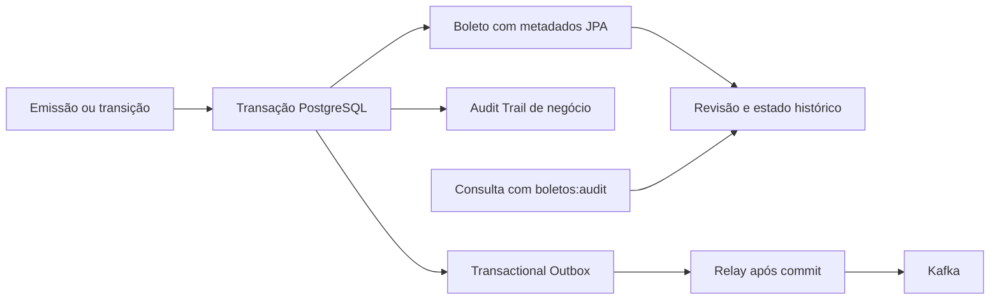

# Auditoria e Histórico de Entidades

O boleto mantém três registros complementares. A aplicação grava o estado atual, o histórico técnico e o evento de negócio na mesma transação quando uma emissão ou transição é confirmada. O relay publica o evento depois do commit.

| Estrutura | Responsabilidade |
| --- | --- |
| `boleto` | Estado corrente, versão otimista e metadados de criação e última alteração. |
| `boleto_revision` | Número global, timestamp da revisão, autor e correlation ID. |
| `boleto_revision_state` | Estado técnico do boleto por revisão, incluindo a versão do agregado. |
| `boleto_audit` | Evento de negócio com identidade, transição, versão e correlação. |
| `boleto_outbox` | Publicação assíncrona dos eventos de negócio existentes. |

## Gravação e correlação

O Spring Data JPA preenche `created_at`, `updated_at`, `created_by` e `updated_by` por meio do relógio da aplicação e do subject do JWT validado. Criação e atualização têm o mesmo timestamp na inserção. Operações sem JWT, como a expiração agendada, usam `system:boleto`. Uma expiração disparada por uma requisição autenticada guarda o subject que disparou a operação. O timestamp Envers representa o instante de criação da revisão, com precisão de milissegundos.

A revisão e o evento compartilham o trace ID quando há um span ativo. Sem span, usam o UUID do primeiro evento da transação. Uma gravação JPA sem evento recebe um correlation ID próprio. Para localizar o evento do mesmo boleto, combine o ID do boleto e a versão do agregado e confira a correlação. O trace ID pode identificar vários registros. Use o event ID para identificar um evento individual.

### Fluxo transacional e leitura

O diagrama mostra os registros envolvidos na emissão e nas transições, e a origem das consultas históricas.



## Consultas

Todas as rotas exigem JWT com o escopo `boletos:audit`, com as mesmas permissões globais do ambiente sintético existente.

```http
GET /api/v1/boletos/{id}/revisions?size=20
GET /api/v1/boletos/{id}/revisions?before=42&size=20
GET /api/v1/boletos/{id}/revisions/42
GET /api/v1/boletos/{id}/revisions/compare?from=39&to=42
```

A lista vem em ordem decrescente, aceita de 1 a 100 itens e usa `before` como cursor exclusivo. Use o número da última revisão retornada para obter a próxima página. Um boleto sem revisões retorna lista vazia. O detalhe exige uma revisão do próprio boleto e retorna `404 REVISION_NOT_FOUND` quando ausente. A comparação retorna os nomes dos campos com valores diferentes nos dois estados. Se apenas uma das revisões contiver estado, retorna `state`. As consultas executam em transação de leitura e deixam a expiração pendente para o fluxo de ciclo de vida.

## Limites e retenção

A V6 usa a data de emissão como aproximação de criação para boletos existentes. Metadados antigos sem fonte ficam nulos, e as revisões começam com a primeira gravação JPA após a migração. SQL direto e operações bulk ignoram os listeners JPA e Envers. Uma exclusão JPA, quando permitida pelas restrições referenciais, gera um marcador `DEL` com estado nulo e preserva o histórico anterior. A API atual não oferece exclusão.

O Envers replica os campos auditados a cada revisão. O volume cresce com a frequência de gravações, e a migração atualiza os boletos existentes. A chave composta atende às consultas por boleto e revisão. O histórico técnico exclui `customer_id`, tokens e credenciais. O subject é um identificador de auditoria e recebe a proteção do escopo de histórico. Uma implantação com dados reais precisa definir retenção, autorização por titular e operação da migração conforme o volume.

Consulte a [ADR de adoção seletiva](../decisoes/envers.md), o [modelo de dados](../operacao/dados.mdx) e a [referência da API](../referencia/api.md).
