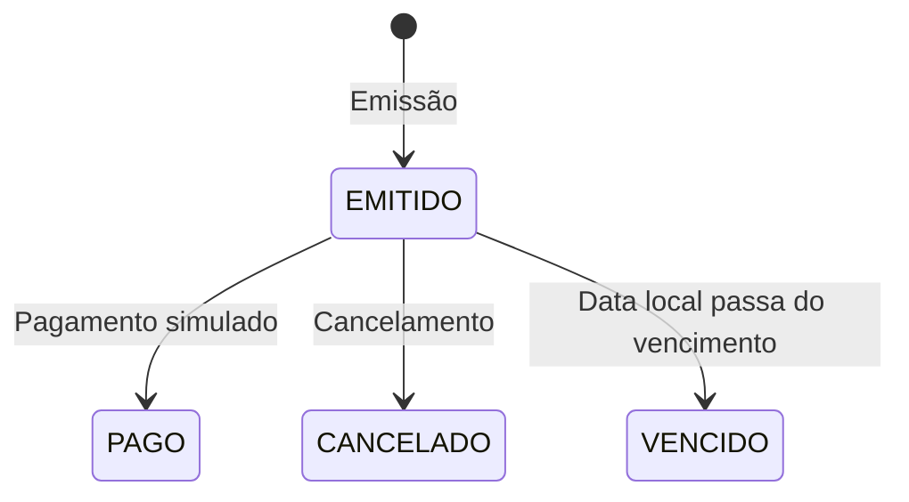
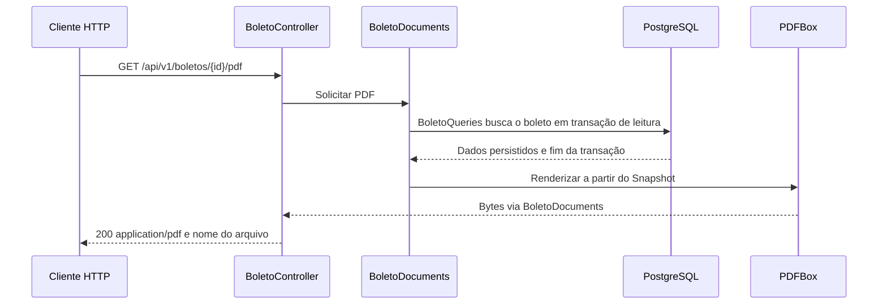

## Emissão e documento

Um boleto educacional começa em `EMITIDO` e recebe um UUID gerado pela
aplicação. O valor está em BRL, de 0,01 a 999.999,99, e é normalizado para duas
casas decimais sem arredondar. A primeira emissão exige vencimento futuro
segundo o relógio em `America/Sao_Paulo`.

O PDF é renderizado sob demanda a partir dos dados persistidos. Ele contém
um aviso visível de documento educacional sem validade para pagamento e não
contém linha digitável ou código de barras com aparência pagável. Uma falha
de renderização preserva o boleto e sua identidade.

## Transições

No dia do vencimento, o estado efetivo ainda é `EMITIDO`. No dia seguinte,
um boleto emitido passa a ser considerado `VENCIDO`. Os estados `PAGO`,
`CANCELADO` e `VENCIDO` são terminais. Comandos rejeitados por estado
recebem `409 INVALID_STATE_TRANSITION`. O vencimento original permanece.

A listagem avalia o estado efetivo sem gravar. Consulta de detalhe, histórico
e comando podem materializar o vencimento e gravar o evento uma única vez.
A tarefa periódica também reconcilia boletos ainda não acessados em lotes de
até 50. O download de PDF usa o caminho de leitura.

A auditoria guarda a origem técnica `API` ou `SYSTEM`, a mudança de estado,
o instante e o identificador de correlação. Veja o [contrato REST](../referencia/api.md)
e os [eventos de ciclo de vida](../referencia/eventos.md).

## Geração do PDF

A consulta de leitura termina antes da renderização em memória. Consulte também a [API REST](../referencia/api.md).

