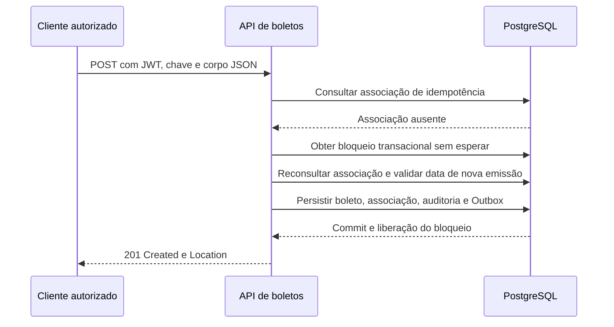
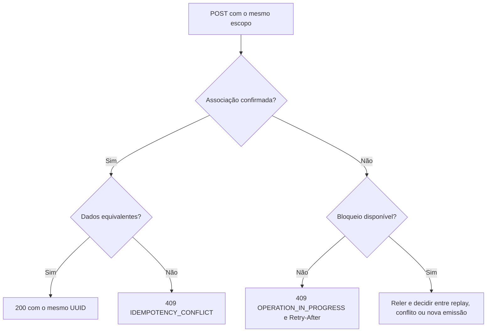

O `POST /api/v1/boletos` requer exatamente um `Idempotency-Key`. Seu escopo
é a combinação do cliente fictício, da operação fixa `ISSUE_BOLETO` e da
chave. A chave é sensível a maiúsculas e minúsculas, tem entre 1 e 160
caracteres ASCII imprimíveis sem espaços e não admite vírgula no HTTP.
Chaves não expiram automaticamente.

A comparação usa o cliente, o valor normalizado e a data ISO de vencimento.
`10` e `10.00` são equivalentes. Ordem e espaços do JSON não influenciam a
comparação. Após a emissão, o replay equivalente continua válido após a data
original de vencimento e retorna o mesmo UUID com o estado efetivo atual.

## Fluxo de emissão

## Repetições e conflitos

A restrição única `uq_issuance_scope` é a garantia de unicidade. O advisory
lock transacional de 64 bits permite responder rapidamente a disputas.
Uma colisão de hash pode induzir contenção temporária de escopos distintos,
mas a busca pelo escopo completo e a restrição impedem que os escopos
compartilhem um boleto. Após rollback, a chave pode ser tentada novamente.

Para o conflito temporário, aguarde o `Retry-After: 1` e repita a mesma
requisição. Para `IDEMPOTENCY_CONFLICT`, mantenha os dados originais ou use
uma chave nova para uma emissão diferente. Veja a
[tabela de respostas HTTP](../referencia/api.md).
