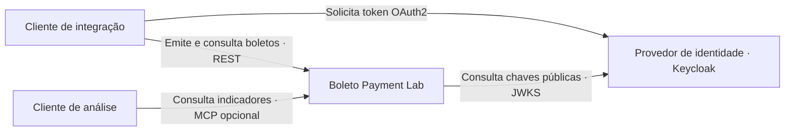
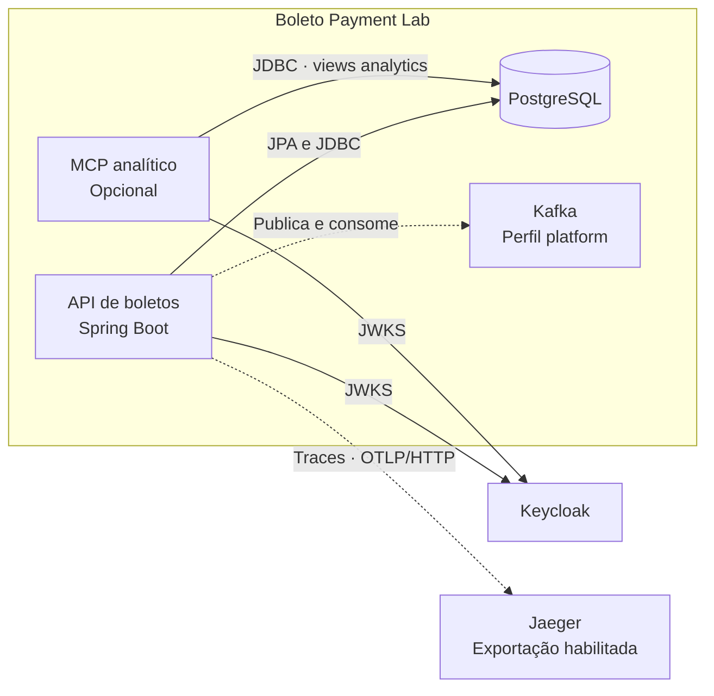
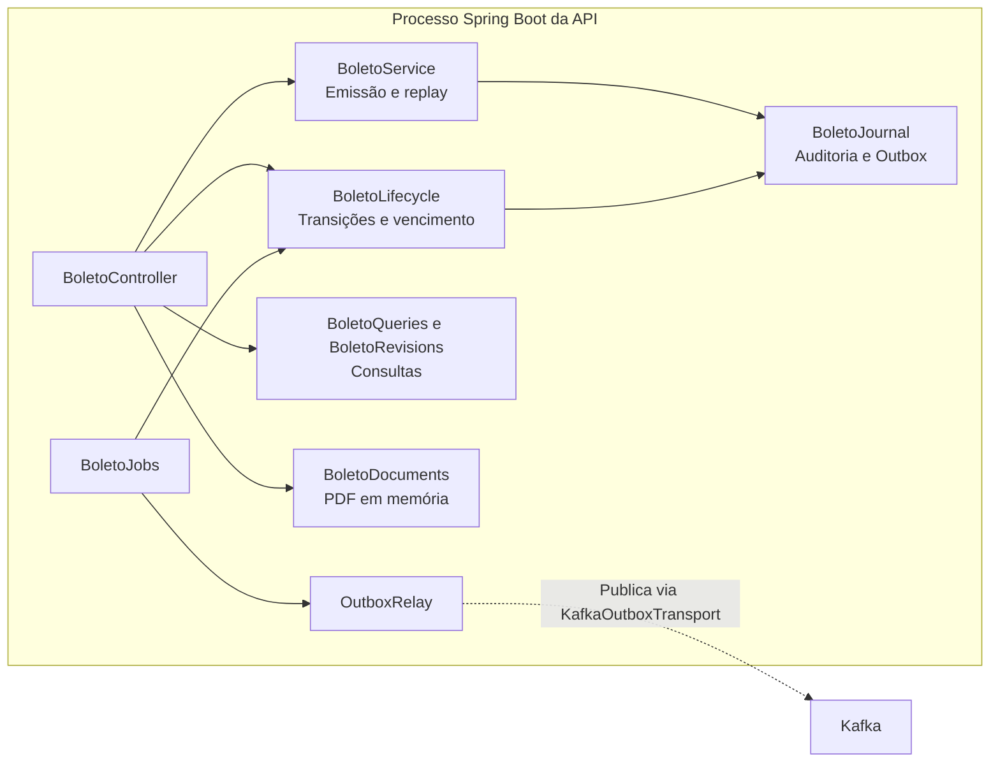

O Boleto Payment Lab é uma aplicação Spring Boot 4.2.0 com Java 25, organizada
como monólito modular. O PostgreSQL é a fonte de verdade para emissão, estado,
auditoria e eventos pendentes. Keycloak, Kafka e Jaeger são serviços locais
externos ao processo da API. O MCP analítico executa em outro processo e
consulta somente as views do PostgreSQL.

## C1 · Contexto do sistema

O contexto apresenta as interfaces do laboratório e o provedor de identidade.
Consulte a [referência REST](../referencia/api.md) e os
[fluxos de autenticação](../operacao/seguranca.md). Para clientes MCP externos,
veja o [fluxo OAuth da integração](../operacao/mcp-analytics.md#como-conectar-o-boleto-analytics-mcp-ao-chatgpt).

## C2 · Aplicações e serviços

As linhas pontilhadas representam eventos e exportação de traces. A API usa
SASL_SSL para publicar e consumir no Kafka. A API e o
MCP são processos independentes. O commit de uma emissão depende do
PostgreSQL. O relé publica o evento posteriormente quando habilitado.

| Elemento | Quando participa | Evidência no repositório |
| --- | --- | --- |
| API REST | JVM no host ou contêiner com perfil Compose `app`. | `settings.gradle.kts`, `BoletoPaymentLabApplication`, `BoletoController` e `compose.yaml`. |
| PostgreSQL | Persistência da API e leitura analítica do MCP. | `application.yaml`, migrações em `src/main/resources/db/migration/` e `AnalyticsRepository`. |
| Kafka | O perfil Spring `platform` habilita eventos por padrão. O Compose base sobe o broker e o provisionador. | `application-platform.yaml`, `infra/kafka/server.properties`, `KafkaSecurity.java` e `compose.yaml`. |
| Keycloak | Emissor local de JWT. O overlay de ChatGPT tem um emissor dedicado ao MCP. | `BoletoSecurity`, `AnalyticsSecurity`, `compose.yaml` e `compose.chatgpt.yaml`. |
| Jaeger | Destino do OTLP quando a exportação está ativa. | `application-platform.yaml`, `application.yaml` e `compose.yaml`. |
| MCP analítico | Módulo Gradle independente e perfil Compose opcional `mcp`. | `settings.gradle.kts`, `BoletoAnalyticsMcpApplication`, `AnalyticsRepository` e `compose.yaml`. |
| Provisionador e Kafbat UI | O provisionador executa uma vez na inicialização. A UI de metadados é opcional. | `compose.yaml` e `infra/kafka/KafkaSecurity.java`. |

A [vista de implantação](../operacao/docker.md#implantação-por-rede-e-perfil)
mostra os perfis Compose, redes e dependências de inicialização.

## C3 · Componentes da API

A vista destaca a coordenação dos fluxos. Veja a
[sequência de emissão](./idempotencia.md#fluxo-de-emissão), os
[estados do boleto](./dominio.md#transições) e a
[sequência de consumo e publicação](../referencia/eventos.md#processamento-assíncrono).

## Estrutura Java

Os pacotes abaixo estão sob `org.example.samplemicroservice`. A classe de
inicialização é `BoletoPaymentLabApplication` e a identidade do processo
Spring é `BoletoPaymentLab`.

| Pacote | Responsabilidade |
| --- | --- |
| `boleto.api` | Rotas MVC, DTO de entrada, respostas, ProblemDetail e correlação HTTP. |
| `boleto.application` | Emissão e replay, consultas, transições, relógio e observações. |
| `boleto.domain` | Estados do boleto e cálculo do estado efetivo. |
| `boleto.infra` | Entidades JPA, repositórios, consultas e bloqueio de emissão. |
| `boleto.document` | Renderização em memória com PDFBox. |
| `boleto.events` | Auditoria, Outbox, publicação, consumidor e tarefas agendadas. |
| `security` | OAuth2 Resource Server, validação JWT e autorização por rota. |

## Separação dos casos de uso

`BoletoService` coordena a emissão e o replay. `BoletoQueries` concentra as
consultas de leitura, incluindo a busca usada por `BoletoDocuments`. O
record `Snapshot` representa os dados usados nas respostas e no PDF.
`BoletoLifecycle` coordena comandos e consultas de detalhe e histórico que
podem materializar o vencimento.

## Padrões de projeto em uso

| Padrão | Classes e motivo |
| --- | --- |
| Adapter | `PdfRenderer` permite que `BoletoDocuments` solicite o PDF em memória. `PdfBoxRenderer` implementa esse contrato com PDFBox. `OutboxTransport` permite que `OutboxRelay` aguarde a confirmação da publicação por meio de `KafkaOutboxTransport`. Esses contratos também permitem simular falhas nos testes. |
| Transactional Outbox | `BoletoJournal` grava auditoria e Outbox junto da alteração do boleto. `OutboxRelay` publica os eventos pendentes e `BoletoEventConsumer` deduplica entregas por ID. `BoletoEventType` concentra os nomes que a gravação e o consumidor compartilham. |

As alternativas avaliadas estão registradas no
[ADR 006](../decisoes/fronteiras-de-aplicacao.md). A revisão em
`specs/architecture-review.md` relaciona as mudanças com os cenários
`UC-BPL-001` S01, S06 e S12 e `UC-BPL-002` S14, S15 e S17–S19.

## Limites transacionais

Na emissão, boleto, chave de idempotência, auditoria e Outbox são gravados
na mesma transação. Na alteração de estado, a linha do boleto é bloqueada
durante a transição e os registros correspondentes. O publisher usa
transações curtas por evento, com espera de rede limitada. A geração de PDF
lê o boleto persistido e renderiza o arquivo em memória.

Leia [Regras de negócio](./dominio.md), [Eventos](../referencia/eventos.md)
e [PostgreSQL e Flyway](../operacao/dados.mdx) para os detalhes de cada fluxo.
Use o [Explorador de Arquitetura](./explorador.mdx) para seguir as conexões
e abrir a referência de cada componente.

## Revisar diagramas em um PR

Compare o diff com a branch de destino e use a tabela para localizar as
vistas que podem precisar de atualização. Uma alteração de código pede
revisão do diagrama quando muda um componente, limite, dependência,
protocolo, perfil ou garantia documentada.

| Mudança no repositório | Vistas para revisar |
| --- | --- |
| Módulos Gradle, aplicações Spring Boot ou contratos REST e MCP | Contexto, aplicações e componentes e [Explorador](./explorador.mdx). |
| Compose, listeners ou ACLs em `infra/kafka/` | [Implantação](../operacao/docker.md#implantação-por-rede-e-perfil) e [Segurança Kafka](../operacao/kafka-seguro.md). |
| Emissão, transações, migrações ou consumo | [Idempotência](./idempotencia.md), [dados](../operacao/dados.mdx), [ciclo de vida](./dominio.md) e [Outbox](../referencia/eventos.md). |
| OAuth2, Keycloak ou configuração de traces | [Autenticação](../operacao/seguranca.md), [MCP](../operacao/mcp-analytics.md) e [observabilidade](../operacao/observabilidade.md). |

Registre no PR o elemento afetado, arquivo ou configuração que comprova a
mudança, diagrama envolvido, correção proposta e grau de confiança. A
pipeline de documentação executa o typecheck e o build do portal.
O build produz as páginas. Confira o SVG renderizado no navegador e
inspecione legibilidade, tema escuro e viewport estreita. O botão
**Baixar SVG** permite exportar o resultado. A fonte editável fica na
página correspondente.
