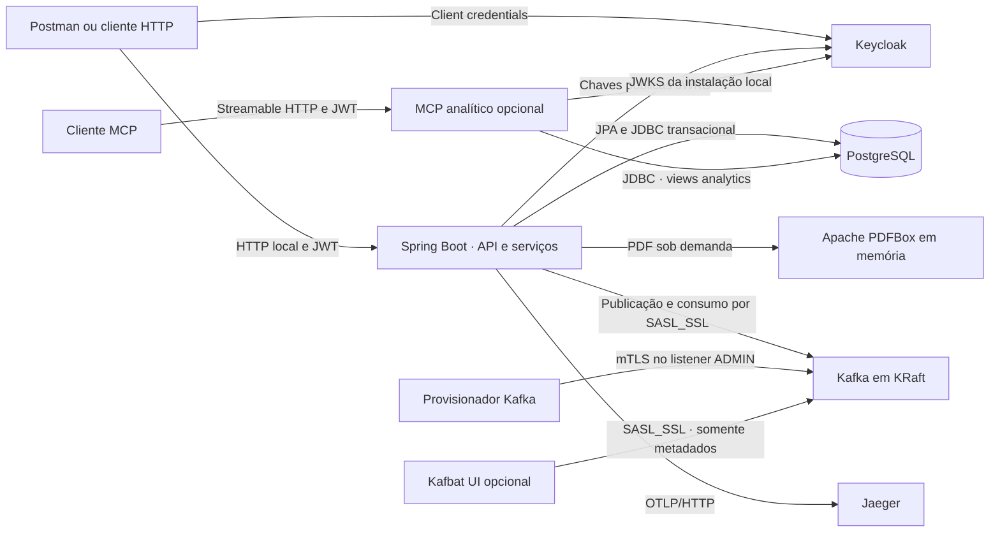

O Boleto Payment Lab é uma aplicação Spring Boot 4.2.0 com Java 25, organizada
como monólito modular. O PostgreSQL é a fonte de verdade para emissão, estado,
auditoria e eventos pendentes. Keycloak, Kafka e Jaeger são serviços locais
externos ao processo da API. O MCP analítico executa em outro processo e
consulta somente as views do PostgreSQL.

## Componentes

O endereço padrão da aplicação usa HTTP e bind em loopback. O cliente obtém o
JWT antes de chamar a API. O emissor do JWT e o broker podem falhar de forma
independente do banco. Um boleto já confirmado mantém seus registros
transacionais mesmo quando a publicação está indisponível.
Veja [Segurança do Kafka](../operacao/kafka-seguro.md),
[MCP analítico](../operacao/mcp-analytics.md) e
[Observabilidade](../operacao/observabilidade.md) para os fluxos detalhados.

## Estrutura Java

Os pacotes abaixo estão sob `org.example.samplemicroservice`. A classe de
inicialização é `BoletoPaymentLabApplication` e a identidade do processo
Spring é `BoletoPaymentLab`.

| Pacote | Responsabilidade |
| --- | --- |
| `boleto.api` | Rotas MVC, DTO de entrada, respostas, ProblemDetail e correlação HTTP. |
| `boleto.application` | Emissão e replay, consultas, transições, relógio e observações. |
| `boleto.domain` | Estados do boleto e cálculo do estado efetivo. |
| `boleto.infra` | Entidades JPA, repositórios, consultas e bloqueio de emissão. |
| `boleto.document` | Renderização em memória com PDFBox. |
| `boleto.events` | Auditoria, Outbox, publicação, consumidor e tarefas agendadas. |
| `security` | OAuth2 Resource Server, validação JWT e autorização por rota. |

## Separação dos casos de uso

`BoletoService` coordena a emissão e o replay. `BoletoQueries` concentra as
consultas de leitura, incluindo a busca usada por `BoletoDocuments`. O
record `Snapshot` representa os dados usados nas respostas e no PDF.
`BoletoLifecycle` coordena comandos e consultas de detalhe e histórico que
podem materializar o vencimento.

## Padrões de projeto em uso

| Padrão | Classes e motivo |
| --- | --- |
| Adapter | `PdfRenderer` permite que `BoletoDocuments` solicite o PDF em memória. `PdfBoxRenderer` implementa esse contrato com PDFBox. `OutboxTransport` permite que `OutboxRelay` aguarde a confirmação da publicação por meio de `KafkaOutboxTransport`. Esses contratos também permitem simular falhas nos testes. |
| Transactional Outbox | `BoletoJournal` grava auditoria e Outbox junto da alteração do boleto. `OutboxRelay` publica os eventos pendentes e `BoletoEventConsumer` deduplica entregas por ID. `BoletoEventType` concentra os nomes que a gravação e o consumidor compartilham. |

As alternativas avaliadas estão registradas no
[ADR 006](../decisoes/fronteiras-de-aplicacao.md). A revisão em
`specs/architecture-review.md` relaciona as mudanças com os cenários
`UC-BPL-001` S01, S06 e S12 e `UC-BPL-002` S14, S15 e S17–S19.

## Limites transacionais

Na emissão, boleto, chave de idempotência, auditoria e Outbox são gravados
na mesma transação. Na alteração de estado, a linha do boleto é bloqueada
durante a transição e os registros correspondentes. O publisher usa
transações curtas por evento, com espera de rede limitada. A geração de PDF
lê o boleto persistido e renderiza o arquivo em memória.

Leia [Regras de negócio](./dominio.md), [Eventos](../referencia/eventos.md)
e [PostgreSQL e Flyway](../operacao/dados.mdx) para os detalhes de cada fluxo.
Use o [Explorador de Arquitetura](./explorador.mdx) para seguir as conexões
e abrir a referência de cada componente.
