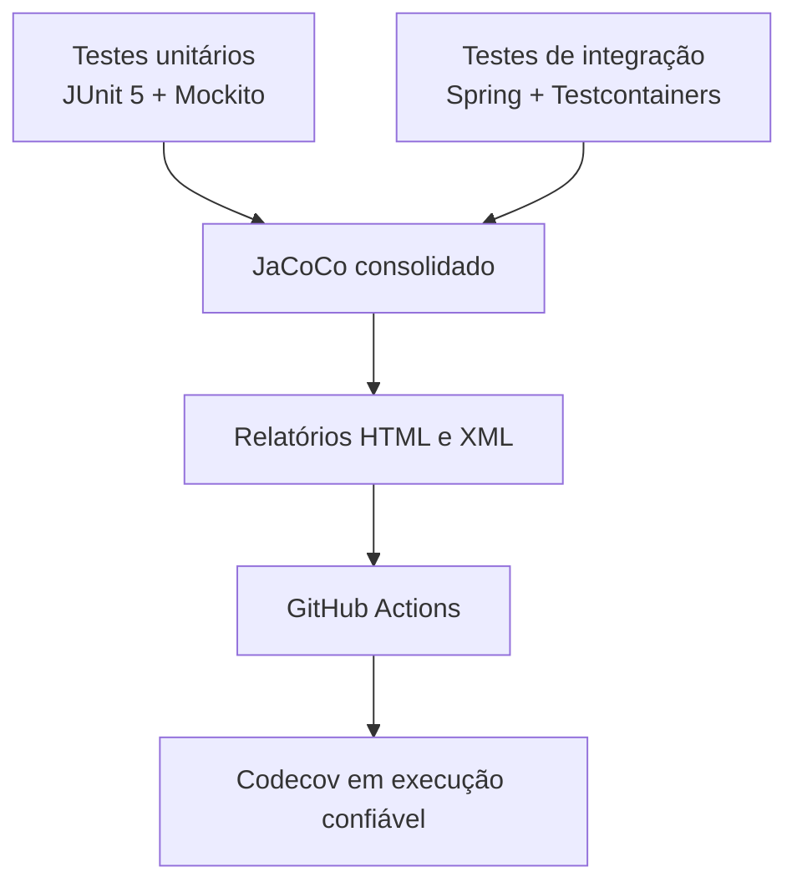

Esta página descreve a estratégia que valida o comportamento implementado do Boleto Payment Lab. Ela referencia `RES-BPL-001`, `RES-BPL-004`, `UC-BPL-001` (S01–S13) e `UC-BPL-002` (S14–S21).



## Pirâmide e isolamento

| Nível | Tarefa Gradle | Dependências | Escopo atual |
| --- | --- | --- | --- |
| Unitário da API | `:test` | Nenhuma infraestrutura externa | validação de emissão, estado do boleto, tipos de eventos e renderização de documento. Mockito é usado apenas no colaborador de renderização. |
| Integração | `integrationTest` | Spring, PostgreSQL e Kafka descartáveis | HTTP interno, Flyway, JPA, auditoria, idempotência, Outbox, deduplicação de eventos e concorrência. |
| Contrato e integração do MCP | `:boleto-analytics-mcp:test` | Spring e PostgreSQL descartável | contrato MCP, validação de JWT e consultas com papel de leitura. |

Não há atualmente cliente HTTP externo de negócio. Por isso, WireMock não é uma dependência do projeto: a verificação de JWKS usa um servidor JDK local e não simula uma integração bancária inexistente.

## Containers e assincronia

`PostgresIntegrationTest` inicia um PostgreSQL `postgres:16.11-alpine`
por JVM de testes de integração da API. Cada cenário que solicita um nome
`bpl_it_*` recebe um banco próprio dentro desse contêiner. O Flyway cria
o esquema de negócio e um `analytics` nesse banco, isolando também as
views analíticas entre cenários. O módulo MCP tem seu próprio PostgreSQL
descartável. Por padrão, o teste do Outbox também inicia um Kafka
`apache/kafka:4.2.2`.

Os testes recebem a URL JDBC do Testcontainers e o PostgreSQL descartável
é parado ao encerrar a JVM, sem reutilização persistente. O banco de
desenvolvimento do Compose e seus esquemas `public` e `analytics` ficam
fora desse ciclo. A suíte atual não remove esquemas de execuções legadas
que já existam no banco de desenvolvimento.

O [workflow Test coverage](https://github.com/jonatadev/BoletoPaymentLab/blob/main/.github/workflows/coverage.yaml)
executa as suítes de integração e do MCP em um runner Linux com Docker.
Localmente, inicie o Docker Desktop antes de executar essas suítes.

As verificações assíncronas usam Awaitility, com timeout limitado e condição observável. Não são usados `Thread.sleep` como sincronização de mensagens.

## Executar localmente

```powershell
.\gradlew.bat test
.\gradlew.bat integrationTest
.\gradlew.bat jacocoTestReport
```

O relatório HTML está em `build/reports/jacoco/test/html/index.html` e o XML em `build/reports/jacoco/test/jacocoTestReport.xml`. O XML é enviado ao Codecov somente por execuções confiáveis do workflow; pull requests de forks continuam executando testes, mas não recebem o segredo de upload.

## Desempenho e diagnóstico

O objetivo é manter `test` abaixo de 15 segundos e `integrationTest` abaixo de dois minutos, sem reduzir isolamento. Meça os tempos reais: o primeiro uso pode demorar mais pelo download das imagens. Falhas de conexão com Docker não indicam falha de regra de negócio; verifique o daemon e as permissões do usuário antes de repetir a suíte.

```powershell
.\gradlew.bat integrationTest --tests "*.BoletoEventsPostgresTests" --info
```

Consulte também [Testes e validação](./testes.md), [Qualidade e cobertura](./cobertura.md) e [Eventos](../referencia/eventos.md).
