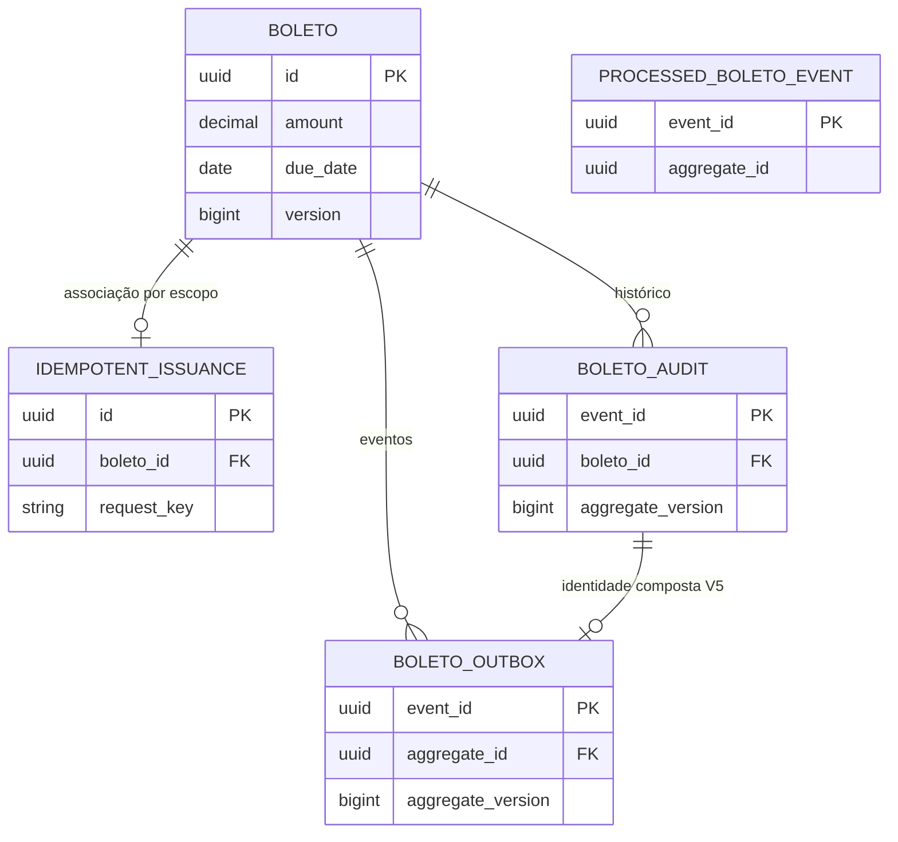
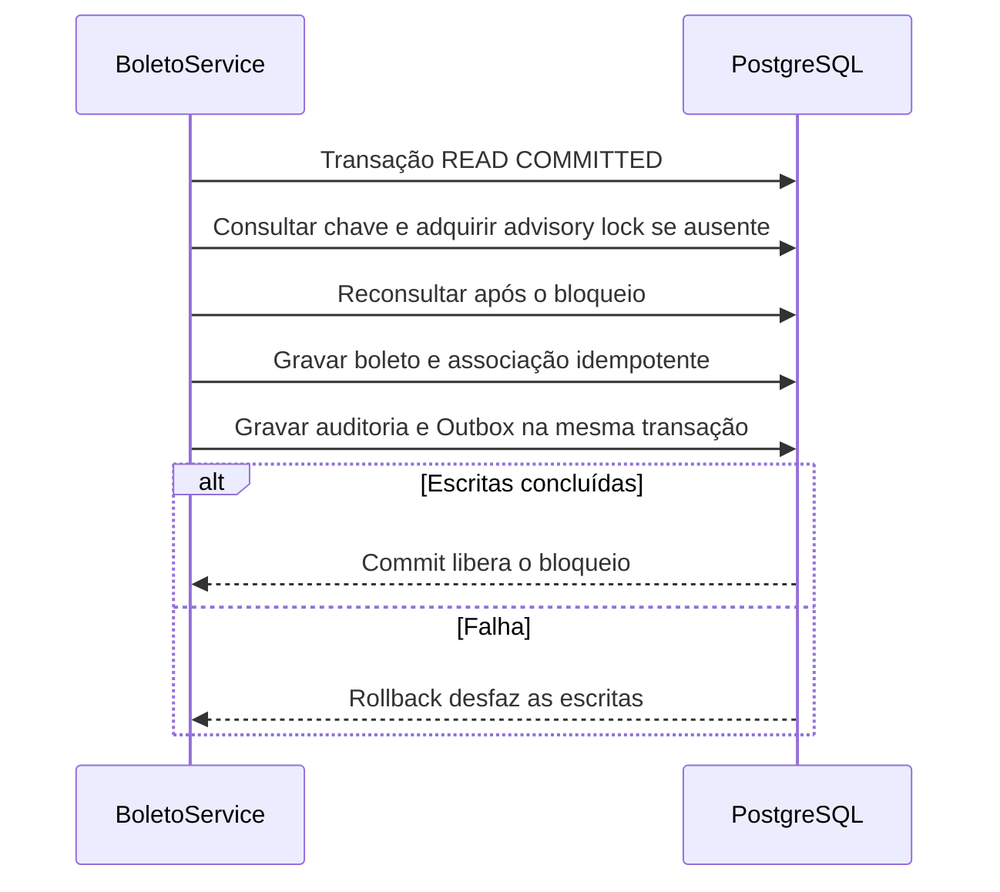

import TechnicalImage from '../../src/components/TechnicalImage';

O PostgreSQL garante a integridade dos registros operacionais. JPA é usado
para emissão, ciclo de vida e consultas. O journal e o Outbox usam JDBC
dentro das transações Spring.

| Tabela | Conteúdo e garantia principal |
| --- | --- |
| `boleto` | UUID, cliente fictício, valor, data original, estado, instante de emissão e versão. |
| `idempotent_issuance` | Associação única por cliente, operação e chave, com referência única ao boleto. |
| `boleto_audit` | Histórico imutável por versão do agregado, com origem e correlação. |
| `boleto_outbox` | Evento pendente ou publicado, agenda de novas tentativas e contexto de trace. |
| `processed_boleto_event` | Recibo persistente, único por `eventId`, do consumidor educacional. |

As tabelas de auditoria e Outbox compartilham o identificador do evento.
Os índices dão suporte a listagem por emissão, filtro cliente/período,
busca de vencidos e seleção de eventos pendentes. A versão do boleto e as
transações limitam disputas em mudanças de estado.

## Migrações incrementais

Flyway lê as migrações compartilhadas em `src/main/resources/db/migration`
e seleciona o diretório do SGBD em `src/main/resources/db/vendor`. A V5
fica em `db/vendor/postgresql`. O teste de inicialização em H2 usa V1–V4.
Em configurações locais antigas, remova a sobrescrita de
`spring.flyway.locations` que aponta só para o diretório compartilhado,
ou inclua os dois locais.

<TechnicalImage images={[{
  src: '/img/outbox-audit-v5.svg',
  alt: 'A chave estrangeira associa evento, boleto e versão do Outbox à mesma linha de auditoria.',
  caption: 'Flyway V5. O ID do agregado no Outbox referencia o ID do boleto na auditoria.',
  width: 800,
  height: 310,
}]} />

| Versão | Mudança |
| --- | --- |
| V1 | Tabelas de emissão e idempotência, restrição monetária e unicidade do escopo. |
| V2 | Estado, instante de emissão, versão e índices de consulta e de expiração. |
| V3 | Auditoria e Outbox transacional. |
| V4 | Recibos do consumidor Kafka. |
| V5 | Chave estrangeira composta entre Outbox e auditoria por evento, boleto e versão. |

A V5 cria um índice único na auditoria e verifica os registros existentes
em uma transação. Use uma janela de manutenção. A espera por locks é limitada
a três segundos e cada comando a 30 segundos. Se o Flyway encontrar uma
divergência, a transação reverte a V5. Para detalhes sobre compatibilidade e
recuperação, consulte o [ADR 003](../decisoes/outbox.md).

Em registros legados, V2 mantém UUID, valor e vencimento originais, inicia
o estado persistido como `EMITIDO` e usa o instante da migração para
`issued_at`. O vencimento efetivo segue a regra normal, sem reconstruir
eventos históricos indisponíveis. A suíte
[`LegacyDatabaseUpgradeTests`](../inicio/testes.md) cobre essa atualização.

Preserve as migrações já aplicadas. Para mudanças de esquema, adicione uma
nova versão. A retenção de auditoria, Outbox e recibos ainda é manual.

## Inspeção somente leitura

A tabela abaixo pode ajudar a verificar o estado do Outbox sem buscar
payloads ou credenciais:

```sql
SELECT
    COUNT(*) FILTER (WHERE published_at IS NULL) AS pending,
    COUNT(*) FILTER (WHERE published_at IS NOT NULL) AS published
FROM boleto_outbox;
```

Para validar saúde e conexão pela API, use a sonda de prontidão descrita em
[Observabilidade](./observabilidade.md).

## Modelo entidade-relacionamento

As relações mostram referências e cardinalidades. O recibo do consumidor usa o ID do evento como chave e pode sobreviver à remoção do Outbox. Consulte [Kafka e Transactional Outbox](../referencia/eventos.md).



## Escrita transacional

O commit fecha a unidade de trabalho antes de devolver 201. Consulte [Idempotência e concorrência](../arquitetura/idempotencia.md).



## Revisões técnicas do boleto

A V6 adiciona metadados JPA em `boleto` e cria `boleto_revision` e `boleto_revision_state`. A chave `(id, rev)` identifica um estado histórico e `rev` referencia os metadados de revisão. O estado histórico não depende de uma referência ao registro corrente. Veja [armazenamento, segurança e limitações](../arquitetura/auditoria.md).
