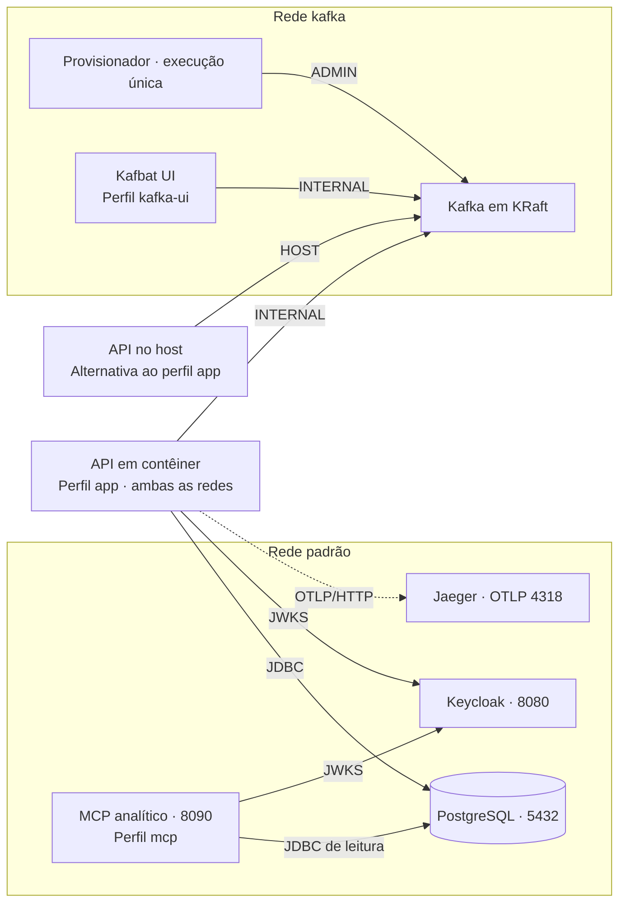

O `compose.yaml` inicia serviços locais para a API executada no host.
As portas publicadas usam `127.0.0.1`. Os serviços conversam pela rede
do Compose quando necessário.

| Serviço | Imagem | Acesso no host |
| --- | --- | --- |
| PostgreSQL | `postgres:17.12-bookworm` | `POSTGRES_PORT`, padrão 5433. |
| Keycloak | `quay.io/keycloak/keycloak:26.8.2` | `KEYCLOAK_PORT`, padrão 8180. |
| Kafka | `apache/kafka:4.2.2` | `KAFKA_PORT`, padrão 9092. |
| Provisionamento Kafka | `boleto-kafka-admin:local` | Execução única, sem porta publicada. |
| Kafbat UI | `ghcr.io/kafbat/kafka-ui:v1.5.1` | Perfil opcional `kafka-ui`, `KAFKA_UI_PORT` (8085). |
| Jaeger | `cr.jaegertracing.io/jaegertracing/jaeger:2.23.0` | UI em `JAEGER_PORT` (16686), OTLP/HTTP em `OTLP_PORT` (4318). |
| BoletoPaymentLab | `boleto-payment-lab:local` | Perfil opcional `app`, HTTP em `APP_PORT` (8080). |
| MCP analítico | `boleto-analytics-mcp:local` | Perfil opcional `mcp`, `MCP_SERVER_PORT` (8090). |

O serviço de aplicação é opcional no perfil `app`. Ele usa a imagem
`boleto-payment-lab:local`, conecta-se aos serviços pelo nome da rede Compose
e publica HTTP somente em loopback.
Para aceitar tokens solicitados pelo Postman no host, siga
[Iniciar a API em contêiner](../inicio/executar.md#iniciar-a-api-em-contêiner).
O [perfil MCP](./mcp-analytics.md#executar-localmente) usa a role leitora
no PostgreSQL e tem configuração própria de issuer e JWKS.

O Kafka usa KRaft com um único nó e uma rede dedicada. Os listeners de
aplicação usam SCRAM sobre TLS. PostgreSQL, Kafka e Keycloak usam
volumes nomeados. O Jaeger usa armazenamento em memória.

O Kafbat UI usa `kafka:29092` na rede dedicada. Após o login, a UI dá acesso
aos metadados do tópico e grupo autorizados. Veja o
[guia de segurança do Kafka](./kafka-seguro.md) para geração de credenciais,
provisionamento e operação.

## Implantação por rede e perfil



As ligações mostram comunicação. A relação de inicialização no
`compose.yaml` exige broker saudável para executar o provisionador. A API
em contêiner e o Kafbat UI aguardam a conclusão do provisionador. A tabela
acima registra as portas publicadas em loopback, incluindo as conexões
da API no host ao PostgreSQL, Keycloak e Jaeger.

Os listeners Kafka `HOST` (9092 por padrão) e `INTERNAL` (29092) usam
SASL_SSL. O provisionador usa mTLS no listener `ADMIN` (29095).
Consulte a [matriz de listeners](./kafka-seguro.md) para os detalhes.

O overlay `compose.chatgpt.yaml` configura o MCP com outro Keycloak e um
proxy OAuth. As rotas do cliente externo e as opções de túnel estão no
[diagrama do MCP](./mcp-analytics.md#como-conectar-o-boleto-analytics-mcp-ao-chatgpt).

## Configuração local

Mantenha as variáveis `POSTGRES_DB`, `POSTGRES_USER`, `POSTGRES_PASSWORD`
e `POSTGRES_PORT` em `.env`. Antes do primeiro boot do Keycloak, defina
`KC_BOOTSTRAP_ADMIN_USERNAME` e `KC_BOOTSTRAP_ADMIN_PASSWORD` nesse arquivo.
O Keycloak importa o realm de `infra/keycloak/boleto-lab-realm.json`.

Se mudar uma porta, ajuste também o cliente correspondente:

| Aplicação | O que ajustar |
| --- | --- |
| PostgreSQL | A URL JDBC em `application-local.yaml` deve usar a porta, o banco e as credenciais existentes. |
| Keycloak | `BPL_OIDC_ISSUER`; ajuste `BPL_OIDC_JWKS` se usar um endereço separado. |
| Kafka | `BPL_KAFKA_BOOTSTRAP`. |
| Jaeger | `BPL_OTLP_ENDPOINT` com o caminho `/v1/traces`. |

## Checagem e diagnóstico

```powershell
python infra/kafka/generate-local.py
docker compose config --quiet
docker compose up -d
docker compose ps
docker compose ps -a kafka kafka-provision
docker compose logs --tail 60 kafka
```

Use a forma silenciosa de `docker compose config` para evitar imprimir
variáveis resolvidas. O status do contêiner e a prontidão da API verificam
camadas diferentes. Para o Keycloak, confira o documento de descoberta em
`/realms/boleto-lab/.well-known/openid-configuration`. O primeiro boot pode
levar alguns minutos.

O Kafka deve ficar `healthy` e `kafka-provision` deve aparecer como
`Exited (0)`. API em contêiner e Kafka UI dependem dessa conclusão.
Para o Jaeger, siga [Logs, métricas e traces](./observabilidade.md)
para conferir a ingestão e a consulta pelo ID do trace.

Alterar variáveis de bootstrap em `.env` não redefine usuários ou senhas
de um volume já inicializado. Ao diagnosticar inicialização, preserve os
volumes e use as credenciais efetivas do banco e do realm.
