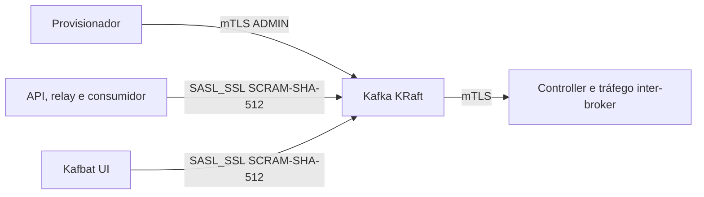

O laboratório usa Kafka 4.2.2 em KRaft. A API, o relay do outbox e o
consumidor compartilham o processo Spring e a identidade `svc-boleto-api`.
O MCP analítico lê PostgreSQL. A UI opcional usa uma identidade Kafka própria
e exibe metadados. A política padrão do broker nega operações sem ACL.

O modelo de ameaças considera interceptação do tráfego local, clientes
sem credenciais, abuso de uma identidade comprometida e acesso a cópias do
volume. TLS protege o transporte, SCRAM ou mTLS identifica cada cliente e
ACLs limitam as operações. A proteção de volumes e backups depende das
permissões e da criptografia na plataforma de armazenamento.

### Fluxo de autenticação e provisionamento

O broker carrega o certificado de nó. O provisionador usa sua própria
identidade mTLS no listener privado ADMIN para criar o tópico e as
credenciais SCRAM ausentes e conferir as ACLs. Credenciais existentes
são validadas. Uma divergência faz o provisionamento falhar. A API
e a UI usam a CA para confirmar a identidade do broker.

| Listener | Endereço | Autenticação |
| --- | --- | --- |
| `HOST` | `127.0.0.1:9092` por padrão | SCRAM-SHA-512 sobre TLS |
| `INTERNAL` | `kafka:29092` na rede Kafka | SCRAM-SHA-512 sobre TLS |
| `CONTROLLER` | `kafka:9093` na rede Kafka | mTLS |
| `REPLICATION` | `kafka:29094` na rede Kafka | mTLS |
| `ADMIN` | `kafka:29095` na rede Kafka | mTLS |



Veja [Docker](./docker.md), [eventos](../referencia/eventos.md) e
[ADR 008](../decisoes/kafka.md). A
[especificação e os cenários KAF-01 a KAF-12](https://github.com/jonatadev/BoletoPaymentLab/blob/main/specs/kafka-security.md)
registram a relação entre os controles e a preservação do fluxo do outbox.

O tópico autorizado é `boleto.lifecycle.v1`. O grupo autorizado é
`boleto-lab-educational`.

| Identidade | Tópico | Grupo |
| --- | --- | --- |
| `svc-boleto-api` | `READ`, `WRITE` | `READ` |
| `svc-kafka-ui` | `DESCRIBE` | `DESCRIBE` |

`READ` e `WRITE` implicam `DESCRIBE`. O produtor idempotente usa
`WRITE` no tópico e preserva `acks=all`. O administrador e a identidade de
nó autenticada por certificado são os únicos superusuários. Os listeners
`REPLICATION`, `CONTROLLER` e `ADMIN` não são publicados no host.

### Instalação local

Execute a partir da raiz com Python 3 e OpenSSL. No Windows, execute no
mesmo usuário que usa o Docker Desktop e indique o caminho do OpenSSL se
ele estiver fora do PATH.

```powershell
python infra/kafka/generate-local.py
docker compose config --quiet
docker compose up -d
docker compose ps -a kafka kafka-provision
docker compose --profile kafka-ui up -d
```

O gerador cria uma CA local, certificados e credenciais aleatórias em
`.kafka-secrets/local/`. A pasta é ignorada pelo Git e excluída do contexto
de build da aplicação. O gerador preserva material existente. Cada
contêiner monta apenas seu diretório. No Linux, conceda acesso de leitura
e travessia aos UIDs dos serviços com ACLs locais caso sejam diferentes do
usuário gerador. O Apache Kafka usa UID 1000 e a API usa UID 10001. Preserve
a chave da CA fora das montagens. No Windows, mantenha a ACL NTFS restrita
ao usuário autorizado e ao sistema.

A sonda do broker realiza mTLS em `REPLICATION` e exige uma resposta
válida do protocolo Kafka. Depois que ela passa, `kafka-provision`
confirma tópico, credenciais e ACLs. Confira o status `Exited (0)`
desse serviço antes de iniciar a API no host. Em caso de falha,
consulte `docker compose logs --tail 60 kafka kafka-provision`.

Para rodar a API no host com os perfis `local,platform`, aponte
`SPRING_CONFIG_IMPORT` para
`file:./.kafka-secrets/local/app/spring.yaml`. Se necessário, ajuste
`BPL_KAFKA_CA` para o PEM público e `BPL_KAFKA_BOOTSTRAP` para a porta
publicada. O login da UI está no arquivo local `ui/application.yaml`; leia-o
localmente, mantendo a senha fora de logs, histórico e tickets. O acesso
HTTP da UI é para loopback. Em produção, use HTTPS para o acesso à UI.

### Alterações de acesso e rotação

Use o listener ADMIN a partir de um contêiner de manutenção na rede Kafka,
com o material administrativo montado em somente leitura. Use
`kafka-acls.sh --bootstrap-server kafka:29095 --command-config /run/kafka/admin.properties`
para revisar e editar ACLs específicas.

- Registre o novo serviço, tópico e grupo na especificação e na política do
  provisionador. Adicione somente as operações necessárias e teste com o
  principal real. Use `--operation WRITE` em vez do atalho `--producer`,
  que também concede criação de tópico.
- Para rotacionar SCRAM, gere um valor novo no cofre, entregue os arquivos
  atualizados e aplique a alteração em uma janela coordenada. Use
  `kafka-configs.sh --alter --entity-type users --entity-name <principal> --add-config-file <arquivo-protegido>`
  com o mesmo bootstrap e `--command-config` administrativo. O arquivo
  protegido contém a propriedade do mecanismo SCRAM. Reinicie o cliente e
  verifique a autenticação. Para rotação sem interrupção, faça a troca por
  um novo principal com as mesmas ACLs mínimas e revogue o anterior.
- Para revogar, retire o principal da política desejada, remova suas ACLs
  exatas e exclua sua credencial SCRAM no broker. Remova o material do
  cliente e verifique a recusa de uma conexão nova. A remoção das ACLs
  bloqueia operações também para sessões que ainda estejam abertas.
- Para trocar a CA, distribua primeiro um bundle de confiança com ambas as
  CAs. Troque certificados de servidor e de cliente e retire a CA antiga
  depois de verificar todas as conexões.

### Diagnóstico e recuperação

| Sinal | O que verificar |
| --- | --- |
| Handshake TLS falha | Cadeia, validade, SAN do host anunciado e CA carregada pelo cliente. |
| SASL falha | Principal, mecanismo e sincronização da credencial entre broker e cliente. |
| Autorização de tópico ou grupo falha | Recurso literal, identidade autenticada e ACL efetiva. |
| Broker indisponível | Healthcheck autenticado, estado do nó KRaft e rede Kafka. |
| Outbox acumula | Contadores de publicação, falhas e traces de `bpl.outbox.publish`. |

Monitore falhas de autenticação e TLS com métricas agregadas do Kafka,
negações com a trilha do autorizador e indisponibilidade com o healthcheck.
No Actuator, use `bpl.kafka.publish.tls.failures`,
`bpl.kafka.publish.authentication.failures`,
`bpl.kafka.publish.authorization.failures` e
`bpl.kafka.consumer.security.stops` quando houver ocorrências.
Encaminhe o registro de alterações administrativas do provisionador e
das ferramentas operacionais para a trilha de auditoria. Mantenha logs sem
payloads, tokens ou credenciais. Restrinja a coleta e retenção ao necessário.

Antes de migrar uma instalação, ensaie em um projeto separado. Agende
uma janela, suspenda escritores durante a troca, registre IDs e offsets
e faça um backup recuperável do volume. Preserve o volume nomeado e
mantenha cópias protegidas dos arquivos de configuração e dos certificados.
Use `python infra/kafka/verify-local.py --mode migration` para ensaiar a
troca com dados sintéticos. O modo `fresh` exercita um volume novo.
Em falha, mantenha os clientes parados e recupere a partir da última
configuração segura ou restaure o backup em um projeto isolado com a
configuração segura. Revalide os IDs e offsets antes de liberar tráfego.

A CA local, a topologia de nó único e os dados sintéticos são escolhas do
laboratório. Em produção, use CA e cofre aprovados, armazenamento e backups
criptografados, trilha administrativa centralizada e nós redundantes.
Restrinja a emissão de certificados para os nomes privilegiados do nó e
do administrador.
