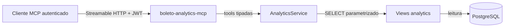

O módulo opcional `boleto-analytics-mcp` expõe consultas analíticas **somente
leitura** sobre dados agregados do Boleto Payment Lab. Ele não participa da
emissão, não consome Kafka, não executa migrations e não oferece uma ferramenta
de SQL livre. A mudança é especificada em
[`specs/mcp-analytics.md`](https://github.com/jonatadev/BoletoPaymentLab/blob/main/specs/mcp-analytics.md).



O diagrama descreve o serviço opcional. A API REST principal continua isolada
do processo analítico.

## Ferramentas disponíveis

| Ferramenta | Dados retornados |
| --- | --- |
| `get_boleto_summary` | total, valor total/médio e distribuição por status |
| `get_boletos_by_day` | dia, quantidade e valor agregado |
| `get_boletos_by_status` | status, quantidade, percentual e valor |
| `get_processing_metrics` | métricas que o modelo atual permite calcular |
| `get_outbox_metrics` | eventos publicados/pendentes e idade do pendente mais antigo |
| `get_database_health` | disponibilidade, latência e versão principal do PostgreSQL |

As consultas aceitam no máximo 366 dias; quando o período é omitido, usam os
30 dias-calendário anteriores. Os resultados não incluem identificadores de
clientes, documentos, payloads de eventos ou dados bancários.

## Segurança

O endpoint Streamable HTTP é `/mcp`, limitado por padrão a `127.0.0.1`. Ele
requer JWT válido para o emissor e audiência configurados, com o escopo
`analytics:read`. O Spring AI não fornece essa barreira automaticamente; ela é
aplicada pelo `AnalyticsSecurity` do módulo.

O banco usa a role separada `boleto_mcp_reader`, com `CONNECT`, `USAGE` no
schema `analytics` e `SELECT` apenas nas views autorizadas. A role inicia
transações como read-only e recebe `statement_timeout` de cinco segundos. O
script `infra/postgres/provision-mcp-reader.sql` deve ser executado por um
administrador **após** a migration V7 criar as views. Não inclua a senha da role
em arquivos versionados.

## Executar localmente

1. Aplique a aplicação principal uma vez para criar as migrations, incluindo
   `V7__analytics_views.sql`.
2. Provisione a role leitora com o script de infraestrutura e uma senha local
   segura.
3. Defina `MCP_DATABASE_URL`, `MCP_DATABASE_USERNAME`,
   `MCP_DATABASE_PASSWORD`, `MCP_AUTH_ISSUER`, `MCP_AUTH_AUDIENCE` e
   `MCP_AUTH_JWKS` no ambiente local.
4. Execute `./gradlew :boleto-analytics-mcp:bootRun` ou use o perfil Compose:

   ```powershell
   docker compose --profile mcp up --build boleto-analytics-mcp
   ```

O perfil expõe a porta apenas em loopback. Para acesso fora da máquina, é
necessário HTTPS, um gateway autenticado e rate limiting; essa política não é
implementada pelo laboratório.

## Clientes MCP

O transporte é Streamable HTTP. A configuração do cliente deve apontar para
`http://127.0.0.1:8090/mcp` e enviar um Bearer token com `analytics:read`.
Use a documentação oficial do seu cliente para o formato de configuração. A
integração direta com Codex, Claude Code ou ChatGPT não foi validada neste
repositório; não exponha o endpoint na Internet para testar essa integração.

## Testes

```powershell
./gradlew :boleto-analytics-mcp:test
./gradlew :boleto-analytics-mcp:jacocoTestReport
```

Os testes incluem validação de períodos, agregações, PostgreSQL real com
Testcontainers, concessões read-only e contrato HTTP MCP (autenticação,
autorização e descoberta de ferramentas). Eles não usam um banco local.

Consulte também [dados e migrations](dados.mdx),
[segurança](seguranca.md) e [observabilidade](observabilidade.md).
