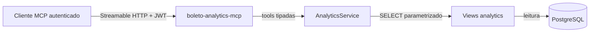
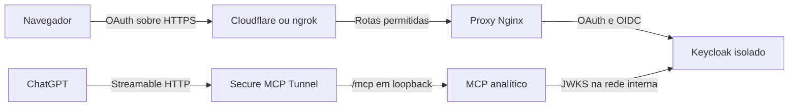

O módulo opcional `boleto-analytics-mcp` expõe consultas analíticas **somente
leitura** sobre dados agregados do Boleto Payment Lab. Ele não participa da
emissão, não consome Kafka, não executa migrations e não oferece uma ferramenta
de SQL livre. A mudança é especificada em
[`specs/mcp-analytics.md`](https://github.com/jonatadev/BoletoPaymentLab/blob/main/specs/mcp-analytics.md).



O diagrama descreve o serviço opcional. A API REST principal continua isolada
do processo analítico.

## Ferramentas disponíveis

| Ferramenta | Dados retornados |
| --- | --- |
| `get_boleto_summary` | total, valor total/médio e distribuição por status |
| `get_boletos_by_day` | dia, quantidade e valor agregado |
| `get_boletos_by_status` | status, quantidade, percentual e valor |
| `get_processing_metrics` | métricas que o modelo atual permite calcular |
| `get_outbox_metrics` | eventos publicados/pendentes e idade do pendente mais antigo |
| `get_database_health` | disponibilidade, latência e versão principal do PostgreSQL |

As consultas aceitam no máximo 366 dias; quando o período é omitido, usam os
30 dias-calendário anteriores. Os resultados não incluem identificadores de
clientes, documentos, payloads de eventos ou dados bancários.

## Segurança

O endpoint Streamable HTTP é `/mcp`, limitado por padrão a `127.0.0.1`. Ele
requer JWT válido para o emissor e audiência configurados, com o escopo
`analytics:read`. O Spring AI não fornece essa barreira automaticamente; ela é
aplicada pelo `AnalyticsSecurity` do módulo.

O banco usa a role separada `boleto_mcp_reader`, com `CONNECT`, `USAGE` no
schema `analytics` e `SELECT` apenas nas views autorizadas. A role inicia
transações como read-only e recebe `statement_timeout` de cinco segundos. O
script `infra/postgres/provision-mcp-reader.sql` deve ser executado por um
administrador **após** a migration V7 criar as views. Não inclua a senha da role
em arquivos versionados.

## Executar localmente

1. Inicie a aplicação principal uma vez para aplicar as migrações do
   [PostgreSQL](./dados.mdx), incluindo V7 e V8 do esquema analítico.
2. Provisione a role leitora com o script de infraestrutura e uma senha local
   segura.
3. Defina `MCP_DATABASE_URL`, `MCP_DATABASE_USERNAME`,
   `MCP_DATABASE_PASSWORD`, `MCP_AUTH_ISSUER`, `MCP_AUTH_AUDIENCE` e
   `MCP_AUTH_JWKS` no ambiente local.
4. Execute `./gradlew :boleto-analytics-mcp:bootRun` ou use o perfil Compose:

   ```powershell
   docker compose --profile mcp up --build boleto-analytics-mcp
   ```

O perfil expõe a porta apenas em loopback. Para acesso fora da máquina, é
necessário HTTPS, um gateway autenticado e rate limiting; essa política não é
implementada pelo laboratório.

No Compose base, o MCP valida o [issuer e a audiência próprios do MCP](./seguranca.md#emissor-e-jwks-no-keycloak).
No Postman, use a pasta **Analytics MCP** com um token local que inclua
`analytics:read`. A sequência de exemplo inicializa a sessão, confirma a
inicialização e consulta as ferramentas e a disponibilidade do banco.

## Provisionar o cliente OAuth do ChatGPT

No Keycloak local, o script configura o cliente público `boleto-chatgpt`
com Authorization Code, PKCE S256 obrigatório, escopo padrão
`analytics:read` e audiência `boleto-analytics-mcp` no access token.
Em um realm novo, o cliente fica desabilitado até receber a URI de retorno.

Copie a URI HTTPS de retorno exata fornecida pelo cliente MCP e execute
na raiz do projeto em PowerShell:

```powershell
$env:CHATGPT_MCP_REDIRECT_URI = Read-Host 'URI HTTPS de retorno'
docker compose exec -T -e CHATGPT_MCP_REDIRECT_URI keycloak bash /opt/keycloak/data/import/configure-chatgpt-mcp.sh
```

O Keycloak precisa estar em execução. O script usa as credenciais
administrativas já fornecidas ao container, substitui a lista de URIs de
retorno desse cliente pela URI informada e relê a configuração para
validar PKCE, o escopo padrão e o mapper de audiência. Uma segunda
execução com a mesma URI deve manter os mesmos recursos.

Esta etapa provisiona o cliente no Keycloak. O endpoint em
`127.0.0.1` continua destinado ao uso local. A conexão hospedada e a
validação ponta a ponta do fluxo OAuth no ChatGPT são etapas separadas.
O cenário [MCP-S06](https://github.com/jonatadev/BoletoPaymentLab/blob/main/specs/mcp-analytics.md)
cobre a rejeição de acessos sem autenticação ou autorização.

## Como conectar o Boleto Analytics MCP ao ChatGPT

Use um workspace com acesso a apps MCP personalizados, um perfil ativo do
OpenAI Secure MCP Tunnel e um hostname HTTPS aprovado para OAuth.
Use apenas dados sintéticos e uma conta de teste sem privilégios
administrativos no realm `boleto-lab`.



O diagrama mostra a configuração opcional. A validação da conexão real
com o ChatGPT está no [roadmap](../roadmap.md).

1. Suba a infraestrutura local pelo procedimento acima e confirme que
   PostgreSQL e a role leitora do MCP estão prontos.
2. Configure `KEYCLOAK_PUBLIC_HOSTNAME` com o hostname aprovado, sem esquema nem
   caminho. Deixe `CHATGPT_MCP_RESOURCE` vazio para a descoberta inicial
   pelo Secure MCP Tunnel. Configure `CHATGPT_KC_ADMIN_USERNAME` e
   `CHATGPT_KC_ADMIN_PASSWORD` apenas no ambiente local ignorado.
3. Recrie apenas o MCP com o overlay e provisione o callback do ChatGPT
   no Keycloak separado:

   ```powershell
   docker compose -f compose.yaml -f compose.chatgpt.yaml --profile mcp up -d --build boleto-analytics-mcp chatgpt-oauth-proxy
   $env:CHATGPT_MCP_REDIRECT_URI = Read-Host 'Redirect URL exata do ChatGPT'
   docker compose -f compose.yaml -f compose.chatgpt.yaml --profile mcp exec -T -e CHATGPT_MCP_REDIRECT_URI keycloak-chatgpt bash /opt/keycloak/data/import/configure-chatgpt-mcp.sh
   ```

4. Após aprovação explícita, configure manualmente o hostname no
   Cloudflare Tunnel nomeado. O origin é
   `http://chatgpt-oauth-proxy:8080`. Injete o token do túnel em
   `CHATGPT_CLOUDFLARE_TUNNEL_TOKEN` localmente. Só então ative o serviço:

   ```powershell
   docker compose -f compose.yaml -f compose.chatgpt.yaml --profile mcp --profile chatgpt-public up -d chatgpt-oauth-tunnel
   ```

5. Use o perfil existente do OpenAI Secure MCP Tunnel, apontado para
   `http://127.0.0.1:8090/mcp` quando o runtime roda no host. Confira
   com `tunnel-client doctor --profile <PERFIL> --explain`, conforme a
   [documentação oficial](https://developers.openai.com/api/docs/guides/secure-mcp-tunnels).
6. Cadastre **Boleto Payment Lab Analytics** no ChatGPT com o túnel
   existente e OAuth2. Use os valores abaixo se a tela aceitar um cliente
   público pré-cadastrado. Autorize com a conta de teste, faça o scan das
   ferramentas e experimente “Quantos boletos foram emitidos nos últimos
   30 dias?”.

| Campo | Valor |
| --- | --- |
| Client ID | `boleto-chatgpt` |
| Client authentication method | `none`, cliente público sem secret |
| Authorization server URL / issuer | `https://<HOST>/realms/boleto-lab` |
| Authorization URL | Issuer + `/protocol/openid-connect/auth` |
| Token URL | Issuer + `/protocol/openid-connect/token` |
| Resource identifier | Valor exato de `resource` observado na descoberta da conexão, igual a `CHATGPT_MCP_RESOURCE` |
| Default scopes | `analytics:read` |
| Basic scopes | Nenhum adicional obrigatório; use `openid` somente se a configuração exigir OIDC |
| PKCE | `S256` |
| OIDC discovery | Issuer + `/.well-known/openid-configuration` |

Para falhas de descoberta, confira `/.well-known/oauth-protected-resource`
no caminho servido pelo túnel do MCP e os metadados do issuer HTTPS.
Em um `401`, verifique assinatura, expiração, issuer e audiência
`boleto-analytics-mcp`. Em um `403`, verifique se o token contém
`analytics:read`. A compatibilidade do identificador `resource` com a
audiência fixa precisa ser comprovada na conexão real. O provisionamento
local não confirma o suporte desse modo de cliente no ChatGPT.

### Preparar o Keycloak isolado para ngrok

O override `compose.chatgpt.ngrok.yaml` publica somente o proxy Nginx
em `127.0.0.1:18082`. Configure o domínio de desenvolvimento
`auth-boleto.example.test` em `KEYCLOAK_PUBLIC_HOSTNAME`,
conforme o comando abaixo. O Keycloak padrão em `8180` continua
separado. O issuer previsto é
`https://auth-boleto.example.test/realms/boleto-lab`.

Defina as credenciais do Keycloak isolado no `.env` ignorado. Em PowerShell,
suba apenas o proxy e seu Keycloak para validar localmente. Com o overlay
ChatGPT, `CHATGPT_MCP_RESOURCE` vazio seleciona o recurso local
`http://127.0.0.1:8090` para descoberta pelo túnel.

```powershell
$env:KEYCLOAK_PUBLIC_HOSTNAME = 'auth-boleto.example.test'
$compose = @('-f', 'compose.yaml', '-f', 'compose.chatgpt.yaml', '-f', 'compose.chatgpt.ngrok.yaml', '--profile', 'mcp')
docker compose @compose config --quiet
docker compose @compose up -d chatgpt-oauth-proxy
$origin = 'http://127.0.0.1:18082'
$hostHeader = "Host: $env:KEYCLOAK_PUBLIC_HOSTNAME"
$realm = '/realms/boleto-lab'
$issuer = "https://$env:KEYCLOAK_PUBLIC_HOSTNAME$realm"
$oidc = curl.exe -fsS -H $hostHeader "$origin$realm/.well-known/openid-configuration" | ConvertFrom-Json
if ($oidc.issuer -cne $issuer) { throw 'Issuer divergente' }
if ($oidc.code_challenge_methods_supported -notcontains 'S256') { throw 'PKCE S256 ausente' }
foreach ($field in @('authorization_endpoint','token_endpoint','jwks_uri')) {
    if (!([string]$oidc.$field).StartsWith("$issuer/", [StringComparison]::Ordinal)) { throw "URL divergente: $field" }
}
$oauth = curl.exe -fsS -H $hostHeader "$origin/.well-known/oauth-authorization-server$realm" | ConvertFrom-Json
if ($oauth.issuer -cne $issuer -or $oauth.token_endpoint -cne $oidc.token_endpoint) { throw 'Descoberta OAuth divergente' }
$jwks = curl.exe -fsS -H $hostHeader "$origin$realm/protocol/openid-connect/certs" | ConvertFrom-Json
if (!$jwks.keys) { throw 'JWKS sem chaves' }
foreach ($path in @('/admin/', '/admin/master/console/', '/realms/master/.well-known/openid-configuration', '/metrics')) {
    $code = curl.exe -sS -o NUL -w '%{http_code}' -H $hostHeader "$origin$path"
    if ($code -ne '404') { throw "Rota não bloqueada: $path ($code)" }
}
```

Aguarde o Keycloak inicializar antes de consultar os endpoints. Os comandos
acima não precisam do ngrok. Após autorização explícita, inicie o agente
apontando para o **proxy**, sem o perfil Cloudflare:

```powershell
ngrok http http://127.0.0.1:18082 --url https://auth-boleto.example.test
```

Configure o authtoken no agente local e mantenha-o fora do repositório.
Repita as consultas de descoberta e os testes de bloqueio usando a
origem HTTPS pública. Só então teste o login com a conta OAuth de
desenvolvimento. O transporte do MCP continua pelo Secure MCP Tunnel.
Para reverter, encerre o agente ngrok e rode
`docker compose @compose stop chatgpt-oauth-proxy keycloak-chatgpt`.

### Identificador do recurso e verificação antes da ativação

Com o overlay ChatGPT e o recurso padrão, os dois documentos devem retornar
`resource: http://127.0.0.1:8090`, o issuer HTTPS em `authorization_servers`
e o escopo `analytics:read`. O `401` de `/mcp` deve apontar para o documento
raiz em `WWW-Authenticate`. O Secure MCP Tunnel reescreve os endereços
para o conector. Confirme o valor externo pelo fluxo real.

```powershell
curl.exe --noproxy "*" http://127.0.0.1:8090/.well-known/oauth-protected-resource
curl.exe --noproxy "*" http://127.0.0.1:8090/.well-known/oauth-protected-resource/mcp
curl.exe --noproxy "*" -i -X POST http://127.0.0.1:8090/mcp
docker compose --profile app --profile mcp config --quiet
# Set the overlay variables locally before validating it:
docker compose -f compose.yaml -f compose.chatgpt.yaml --profile mcp --profile chatgpt-public config --quiet
```

O valor esperado externamente permanece pendente. A documentação da OpenAI
descreve descoberta através do Secure MCP Tunnel e preservação dos
metadados do servidor de autorização. Ela não especifica uma regra que
permita deduzir o identificador pelo nome do túnel. Em uma sessão de teste
autorizada, examine o `resource_metadata` do desafio `401` visto pelo
cliente, consulte esse documento pela conexão e compare o campo
`resource` com o parâmetro `resource` decodificado na solicitação OAuth.
Se aparecer uma URL do serviço de túnel, use a URL completa observada,
incluindo o caminho. Uma divergência entre os valores bloqueia a ativação.

`resource` identifica o servidor de destino nas solicitações OAuth.
`aud` é a audiência assinada no JWT. O mapper existente emite
`boleto-analytics-mcp`, que o MCP exige atualmente. O mapper fixo não
implementa a vinculação dinâmica de `resource` à audiência. Se o fluxo
exigir o identificador HTTPS em `aud`, configure um mapper fixo adicional
para esse identificador aprovado e faça o overlay exigir também essa
audiência, com teste de token incorreto. Não copie valores arbitrários
enviados pelo cliente para `aud`.

### Checklist para ativação futura

- [ ] Confirmar domínio sob controle do operador. O hostname
  `auth-boleto.seudominio.com` e o nome `boleto-keycloak-dev` são exemplos.
- [ ] Preencher `KEYCLOAK_PUBLIC_HOSTNAME`, testar a descoberta pelo túnel
  e confirmar o identificador externo antes de revisar a audiência.
- [ ] Após aprovação, criar o túnel e a rota DNS apontando para o proxy
  do Keycloak isolado. A origem padrão `127.0.0.1:8180` permanece para
  Postman. A rota externa usa `http://chatgpt-oauth-proxy:8080`.
- [ ] Conferir HTTPS, issuer exato, discovery, JWKS interno, bloqueio de
  `/admin` e `/realms/master` e callback com PKCE S256.
- [ ] Conferir `resource`, `aud` e `analytics:read` na troca OAuth real.
  No ChatGPT, listar as seis ferramentas e executar uma consulta
  agregada somente leitura.

O proxy expõe rotas de login e token ao público quando ativado.
Use rate limiting e mantenha a instância atualizada. Para encerrar,
desconecte o app, interrompa o perfil do Secure MCP Tunnel, revogue
sessões de teste e desative a rota/túnel no Cloudflare. Pare os serviços
opcionais com `docker compose -f compose.yaml -f compose.chatgpt.yaml
--profile mcp --profile chatgpt-public stop chatgpt-oauth-tunnel
chatgpt-oauth-proxy keycloak-chatgpt boleto-analytics-mcp`. Se quiser
voltar ao MCP local, recrie-o com o Compose padrão.

## Clientes MCP

O transporte é Streamable HTTP. A configuração do cliente deve apontar para
`http://127.0.0.1:8090/mcp` e enviar um Bearer token com `analytics:read`.
Use a documentação oficial do seu cliente para o formato de configuração. A
integração direta com Codex, Claude Code ou ChatGPT não foi validada neste
repositório; não exponha o endpoint na Internet para testar essa integração.

## Testes

```powershell
./gradlew :boleto-analytics-mcp:test
./gradlew :boleto-analytics-mcp:jacocoTestReport
```

Os testes incluem validação de períodos, agregações, PostgreSQL real com
Testcontainers, concessões read-only e contrato HTTP MCP (autenticação,
autorização e descoberta de ferramentas). Eles não usam um banco local.

Consulte também [dados e migrations](dados.mdx),
[segurança](seguranca.md) e [observabilidade](observabilidade.md).
