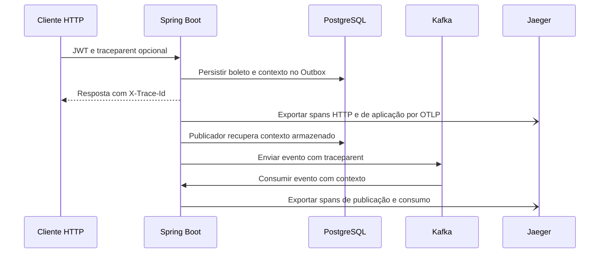

A aplicação registra logs estruturados em JSON no formato ECS. Requisições
instrumentadas correlacionam `traceId` e `spanId` sem incluir o corpo da
requisição, os tokens ou as credenciais. O serviço usa Micrometer Tracing
com OpenTelemetry e propagação W3C.

## Rastrear uma requisição



1. Inicie o perfil `local,platform` e faça uma requisição na
   [API REST](../referencia/api.md).
2. Copie o cabeçalho `X-Trace-Id` da resposta.
3. Abra [a interface local do Jaeger](http://127.0.0.1:16686) e procure
   pelo serviço `BoletoPaymentLab`. Com o ID, abra diretamente
   `http://127.0.0.1:16686/trace/<trace-id>`.
4. Busque o mesmo `traceId` no log. Os campos da linha de acesso identificam
   método, rota e status. Use `spanId` para distinguir a operação.

O perfil `platform` habilita o exportador OTLP por padrão. Use
`BPL_OTLP_ENABLED` e `BPL_OTLP_ENDPOINT` para ajustar o envio. A
amostragem padrão local é `1.0` e pode ser alterada por
`BPL_TRACE_SAMPLE`. **Traces podem ser descartados** quando o coletor está
indisponível. Essa falha não precisa interromper a API.

| Onde a API roda | Endpoint de ingestão OTLP/HTTP |
| --- | --- |
| Host | `http://127.0.0.1:4318/v1/traces` por padrão. |
| Compose, perfil `app` | `http://jaeger:4318/v1/traces` na rede interna. |

A porta `16686` serve a interface e a consulta. A porta `4318`
recebe traces. O Jaeger do Compose mantém os traces em memória e
reiniciar o contêiner descarta esse histórico. Para validar a consulta
de um trace real, inicie o Jaeger e execute o teste de
[S21](https://github.com/jonatadev/BoletoPaymentLab/blob/main/specs/usecases/UC-BPL-002-boleto-lifecycle.md):

```powershell
docker compose up -d jaeger
$env:BPL_IT_JAEGER_QUERY = 'http://127.0.0.1:16686'
$env:BPL_IT_JAEGER_OTLP = 'http://127.0.0.1:4318/v1/traces'
.\gradlew.bat :integrationTest --tests '*BoletoPostgresTests.shouldExportTracesToJaeger'
```

## Saúde e métricas

| Endpoint | Exposição |
| --- | --- |
| `GET /actuator/health` | Status geral. |
| `GET /actuator/health/liveness` | Estado de vida da aplicação. |
| `GET /actuator/health/readiness` | Prontidão, incluindo PostgreSQL. |
| `GET /actuator/metrics` | Lista de métricas, requer `ops:metrics`. |
| `GET /actuator/metrics/{name}` | Medidor individual, com o mesmo escopo. |

Exemplos incluem `http.server.requests`, `bpl.issuance`, `bpl.pdf.render`,
`bpl.boletos.issued`, `bpl.idempotency.conflicts`, `bpl.api.errors`,
`bpl.outbox.published`, `bpl.outbox.errors` e `bpl.events.duplicates`.
Contadores de eventos aparecem depois de observarem a primeira ocorrência.
O Actuator fornece as métricas locais. O envio OTLP para o Jaeger é de traces.
O diagnóstico de TLS, SASL e ACL usa também os
[medidores de segurança Kafka](./kafka-seguro.md#diagnóstico-e-recuperação).
