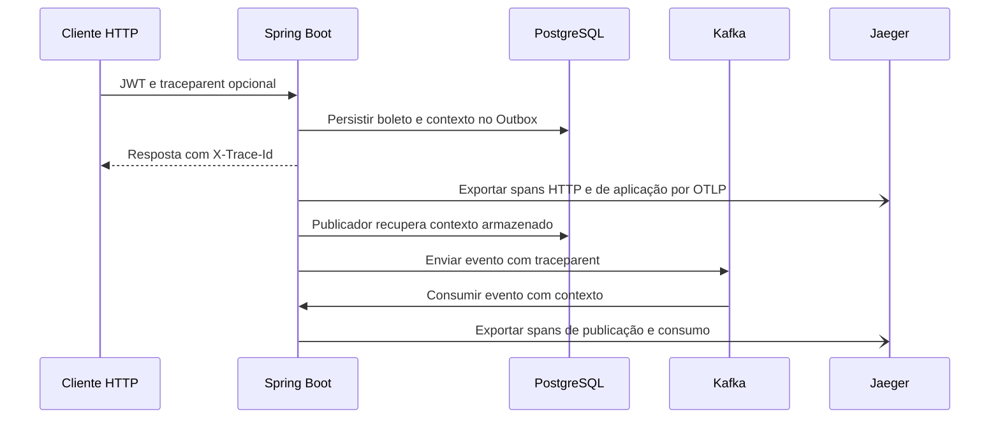
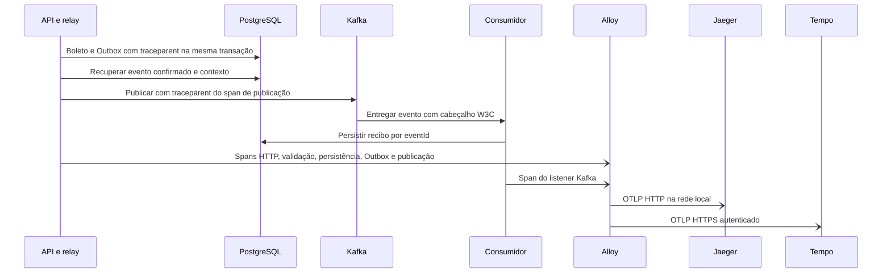

A aplicação registra logs estruturados em JSON no formato ECS. Requisições
instrumentadas correlacionam `traceId` e `spanId` sem incluir o corpo da
requisição, os tokens ou as credenciais. O serviço usa Micrometer Tracing
com OpenTelemetry e propagação W3C.

## Rastrear uma requisição



1. Inicie o perfil `local,platform` e faça uma requisição na
   [API REST](../referencia/api.md).
2. Copie o cabeçalho `X-Trace-Id` da resposta.
3. Abra [a interface local do Jaeger](http://127.0.0.1:16686) e procure
   pelo serviço `BoletoPaymentLab`. Com o ID, abra diretamente
   `http://127.0.0.1:16686/trace/<trace-id>`.
4. Busque o mesmo `traceId` no log. Os campos da linha de acesso identificam
   método, rota e status. Use `spanId` para distinguir a operação.

O perfil `platform` habilita o exportador OTLP por padrão. Use
`BPL_OTLP_ENABLED` e `BPL_OTLP_ENDPOINT` para ajustar o envio. A
amostragem padrão local é `1.0` e pode ser alterada por
`BPL_TRACE_SAMPLE`. **Traces podem ser descartados** quando o coletor está
indisponível. Essa falha não precisa interromper a API.

| Onde a API roda | Endpoint de ingestão OTLP/HTTP |
| --- | --- |
| Host | `http://127.0.0.1:4318/v1/traces` por padrão. |
| Compose, perfil `app` | `http://jaeger:4318/v1/traces` na rede interna. |
| Compose com `compose.tempo.yaml` | `http://alloy:4318/v1/traces` na rede interna. |
| IntelliJ com o mesmo overlay | `BPL_OTLP_ENDPOINT=http://127.0.0.1:14318/v1/traces` e exportação habilitada. |

A porta `16686` serve a interface e a consulta. A porta `4318`
recebe traces. O Jaeger do Compose mantém os traces em memória e
reiniciar o contêiner descarta esse histórico. Para validar a consulta
de um trace real, inicie o Jaeger e execute o teste de
[S21](https://github.com/jonatadev/BoletoPaymentLab/blob/main/specs/usecases/UC-BPL-002-boleto-lifecycle.md):

```powershell
docker compose up -d jaeger
$env:BPL_IT_JAEGER_QUERY = 'http://127.0.0.1:16686'
$env:BPL_IT_JAEGER_OTLP = 'http://127.0.0.1:4318/v1/traces'
.\gradlew.bat :integrationTest --tests '*BoletoPostgresTests.shouldExportTracesToJaeger'
```

## Enviar o mesmo trace ao Jaeger e ao Tempo

Na sua stack Grafana Cloud, abra **Connections → Add new connection → OpenTelemetry**.
Use os dados da conexão OTLP para preencher o `.env` local:

| Variável | Valor |
| --- | --- |
| `GRAFANA_CLOUD_OTLP_HOST` | Host do gateway OTLP exibido para a stack. O Alloy monta `https://<host>/otlp/v1/traces`. |
| `GRAFANA_CLOUD_OTLP_USER` | ID de instância indicado na conexão OTLP. |
| `GRAFANA_CLOUD_TRACES_TOKEN` | Token de Cloud Access Policy limitado à stack com `traces:write`. |

No PowerShell, a partir da raiz:

```powershell
$stack = @('-f', 'compose.yaml', '-f', 'compose.alloy.yaml', '-f', 'compose.tempo.yaml', '--profile', 'app')
docker compose @stack config --quiet
docker compose @stack up -d --build boleto-payment-lab alloy
```

O perfil ativo continua coletando métricas por Prometheus. A aplicação envia
os spans uma vez ao Alloy. Cada exportador tem sua fila em memória e timeout
de 5 s. O exportador Cloud filtra atributos e limita retries a 2 min. Uma
indisponibilidade prolongada pode descartar spans nessa saída. A porta OTLP
para ferramentas no host aceita conexões em loopback (`ALLOY_OTLP_PORT`).



Emita um boleto com o cliente de emissão e uma chave de idempotência nova.
Copie o `X-Trace-Id` do HTTP 201. Em **Explore**, selecione a fonte de
traces da stack e pesquise pelo ID. Abra o mesmo ID no Jaeger local.
Procure o span HTTP de entrada, `bpl.issuance.validate`, `bpl.issuance.persist`,
`bpl.outbox.append`, `bpl.outbox.publish` e o span de consumo do Spring Kafka.
O listener instrumentado cobre o processamento da mensagem. O PDF tem seu
próprio trace quando solicitado em outra requisição.

Uma emissão corresponde a um evento individual. O relay usa o contexto
persistido como pai da publicação e o consumidor recebe o contexto pai pelo
cabeçalho Kafka. Em um lote com várias origens, *span links* poderiam associar
vários contextos ao processamento. Replays sem novo evento não geram outra
publicação.

Para verificar automaticamente a relação de parentesco e o recibo no banco,
execute o teste com o Docker disponível e o Alloy acessível. Ele usa API,
PostgreSQL e Kafka de teste, dados sintéticos e o Jaeger para consulta.

```powershell
$env:BPL_IT_ALLOY_OTLP = 'http://127.0.0.1:14318/v1/traces'
$env:BPL_IT_JAEGER_QUERY = 'http://127.0.0.1:16686'
.\gradlew.bat :integrationTest --tests '*IssuanceTraceTests' --rerun
```

Se o trace aparecer apenas no Jaeger, verifique o usuário OTLP, a permissão
`traces:write` e o host do gateway. Para reduzir o volume enviado, ajuste
`BPL_TRACE_SAMPLE` na aplicação.

## Saúde e métricas

| Endpoint | Exposição |
| --- | --- |
| `GET /actuator/health` | Status geral. |
| `GET /actuator/health/liveness` | Estado de vida da aplicação. |
| `GET /actuator/health/readiness` | Prontidão, incluindo PostgreSQL. |
| `GET /actuator/metrics` | Lista de métricas, requer `ops:metrics`. |
| `GET /actuator/metrics/{name}` | Medidor individual, com o mesmo escopo. |

Exemplos incluem `http.server.requests`, `bpl.issuance`, `bpl.pdf.render`,
`bpl.boletos.issued`, `bpl.idempotency.conflicts`, `bpl.api.errors`,
`bpl.outbox.published`, `bpl.outbox.errors` e `bpl.events.duplicates`.
Contadores de eventos aparecem depois de observarem a primeira ocorrência.
O Actuator fornece as métricas locais. O envio OTLP para o Jaeger é de traces.
O diagnóstico de TLS, SASL e ACL usa também os
[medidores de segurança Kafka](./kafka-seguro.md#diagnóstico-e-recuperação).

## Observabilidade com Grafana Cloud

O perfil `observability` habilita `GET /actuator/prometheus`. O arquivo
`compose.alloy.yaml` acrescenta a coleta opcional ao Compose. A API exporta
traces ao Jaeger por OTLP e o Alloy encaminha as métricas por HTTPS.

### Conectar o Compose ao Grafana Cloud

1. Prepare a aplicação, o banco e o Kafka conforme o [guia Docker](./docker.md).
   Use o projeto Compose habitual para aproveitar seus volumes.
2. No Grafana Cloud, abra os detalhes da instância Prometheus. No arquivo
   local ignorado `.env`, defina as variáveis abaixo, ou forneça-as pelo
   ambiente do processo que executa o Compose.

   | Variável | Valor |
   | --- | --- |
   | `GRAFANA_CLOUD_PROM_HOST` | Host do endpoint de **remote write**, sem protocolo nem caminho. O Alloy acrescenta HTTPS e `/api/prom/push`. |
   | `GRAFANA_CLOUD_PROM_USER` | ID numérico da instância de métricas. |
   | `GRAFANA_CLOUD_METRICS_TOKEN` | Novo token de Access Policy restrito à stack e a `metrics:write`. Revogue o token exposto anteriormente. |
   | `BPL_METRICS_CLIENT_SECRET` | Segredo local do cliente `boleto-metrics` no Keycloak. O Alloy solicita e renova o JWT com o escopo `ops:metrics`. |

3. Na raiz do projeto, execute no PowerShell:

   ```powershell
   $stack = @('-f', 'compose.yaml', '-f', 'compose.alloy.yaml', '--profile', 'app')
   docker compose @stack config --quiet
   docker compose @stack up -d --build alloy
   docker compose @stack ps
   ```

4. No Grafana **Explore**, selecione a fonte Prometheus da stack e consulte
   `up{job="boleto-payment-lab"}`. Uma amostra recente de valor **1** confirma
   scrape e ingestão. Consulte também `process_uptime_seconds{job="boleto-payment-lab"}`.
   Valor **0** indica que o coletor alcançou o destino de escrita, mas a coleta
   da API falhou. Verifique o cliente, escopo, emissor e a prontidão da API.
   Se a série estiver ausente, confira o intervalo de tempo, o host, a instância
   e a permissão de escrita. Consulte `docker compose @stack logs --tail 50 alloy`.

O Alloy opera pela rede interna, sem publicar portas. Cada scrape tem intervalo
de 30 s, timeout de 10 s e limites de 15 mil amostras e 32 labels por série.
Ultrapassar um limite falha a coleta inteira. A fila envia lotes de até mil
amostras, com até dois envios paralelos e backoff de até 30 s para falhas
transitórias. O volume `alloy-data` preserva o WAL após reinícios. A retenção
é limitada e interrupções prolongadas podem causar perda de amostras.
O volume e a cardinalidade das séries afetam disco local e custos na stack.

Use `docker compose @stack stop alloy` para pausar a ingestão. Para rotacionar
credenciais, atualize o ambiente e execute `docker compose @stack up -d --no-deps --force-recreate alloy`.
Restrinja o acesso ao arquivo local e ao daemon Docker, que pode inspecionar
o ambiente do contêiner. Use `config --quiet` para validar sem imprimir segredos.

### Verificação do endpoint no Windows

1. Inicie PostgreSQL e Keycloak conforme o [guia de infraestrutura](./docker.md).
2. No IntelliJ, selecione o JDK 25 e acrescente `observability` aos perfis
   ativos da aplicação, por exemplo `local,observability`. Execute a API.
   Pelo terminal, use `.\gradlew.bat bootRun --args="--spring.profiles.active=local,observability"`.
3. Use o cliente confidencial `boleto-metrics` do realm `boleto-lab`.
   Consulte o segredo local na aba **Credentials** desse cliente no Keycloak.
   O fluxo abaixo pede o segredo sem eco e solicita um JWT de curta duração,
   com audiência `boleto-api` e escopo `ops:metrics`. Esse mesmo fluxo OAuth2
   também é usado pelo coletor. Mantenha o endpoint no loopback do host.

```powershell
$credential = Get-Credential -UserName 'boleto-metrics' -Message 'Segredo local do cliente Keycloak'
$oidc = 'http://127.0.0.1:8180/realms/boleto-lab/protocol/openid-connect/token'
$jwt = Invoke-RestMethod -Method Post -Uri $oidc -Body @{
    grant_type = 'client_credentials'
    client_id = $credential.UserName
    client_secret = $credential.GetNetworkCredential().Password
    scope = 'ops:metrics'
}
$url = 'http://127.0.0.1:8080/actuator/prometheus'
$headers = @{ Authorization = "Bearer $($jwt.access_token)" }
$series = (Invoke-WebRequest -UseBasicParsing -Uri $url -Headers $headers).Content
$series -split "\n" | Select-String '^(bpl_|process_|jvm_gc_|jvm_memory_|http_server_|hikaricp_|kafka_)' | Select-Object -First 40
Remove-Variable credential,jwt,headers
```

Sem JWT, espere **401**. Com um JWT válido de leitura de boletos, espere
**403**. Com o cliente de métricas, espere **200**. Use o cliente de emissão
para emitir e repetir a mesma requisição pela coleção Postman. Colete novamente:
o contador de emissão cresce uma vez e o timer registra duas chamadas.

| Série Prometheus | Como interpretar |
| --- | --- |
| `bpl_boletos_issued_total`, `bpl_boletos_paid_total`, `bpl_boletos_cancelled_total` | Transições confirmadas no PostgreSQL. Replay, rejeição e rollback não aumentam o contador de conclusão. |
| `bpl_issuance_seconds_bucket`, `bpl_pdf_render_seconds_bucket` | Histogramas da tentativa de emissão e da renderização do PDF. As séries associadas `_count` e `_sum` indicam quantidade e tempo acumulado. |
| `bpl_lifecycle_change_seconds_count` | Tentativas de transição por `operation` e `outcome`. Falhas anteriores à entrada na operação são visíveis nas métricas HTTP. |
| `bpl_outbox_pending` | Contagem no banco das linhas sem publicação confirmada, inclusive as aguardando retry. Cada scrape consulta o banco. Réplicas que compartilham o banco observam o mesmo backlog. |
| `bpl_outbox_published_total`, `bpl_outbox_errors_total` | Confirmações de publicação e adiamentos por falha persistidos pelo relay. Retries podem entregar mensagens repetidas. |
| `jvm_memory_used_bytes`, `jvm_gc_memory_allocated_bytes_total`, `process_cpu_usage`, `process_uptime_seconds` | Memória em uso, alocação medida pelo GC, fração de CPU e uptime do processo. |
| `http_server_requests_seconds_bucket`, `http_server_requests_seconds_count` | Latência e tráfego por rota e status HTTP. |
| `hikaricp_connections_active` | Conexões em uso pelo pool da aplicação. |
| `kafka_producer_record_send_total`, `kafka_consumer_fetch_manager_records_consumed_total` | Atividade dos clientes Kafka após sua inicialização. |

Os contadores residem no processo e reiniciam com ele. A auditoria persistida
é a fonte para reconciliação. Evite labels com IDs, chaves de idempotência
ou dados do cliente. Os histogramas geram uma série por combinação de
buckets e labels. Revise a quantidade de séries antes de habilitar ingestão
paga. A referência de segurança e aceitação é RNF-BPL-003/004, UC-BPL-002
(S20 e S21).
