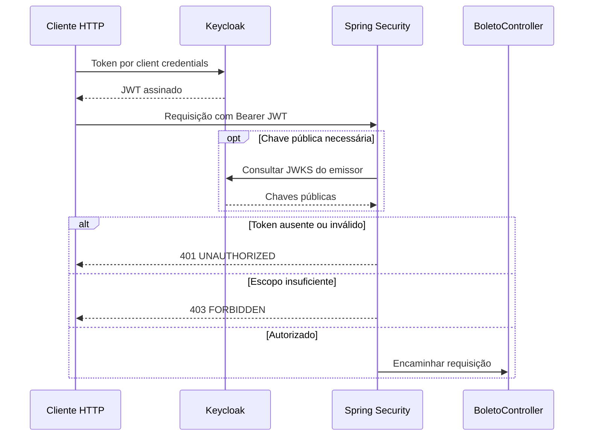

O Spring Security funciona como OAuth2 Resource Server sem sessão.
O Keycloak local emite JWTs para o realm `boleto-lab`. A API verifica
assinatura, emissor, timestamps e a audiência padrão `boleto-api` com
chaves públicas JWKS. As rotas exigem escopos por operação.

As permissões têm alcance sobre os dados sintéticos do laboratório. A
versão atual não modela isolamento de locatários nem propriedade por
cliente. A configuração local vincula a API e os serviços à interface de
loopback.

## Clientes de desenvolvimento

| Cliente OIDC | Escopos |
| --- | --- |
| `boleto-issuer` | `boletos:issue`, `boletos:read` |
| `boleto-reader` | `boletos:read`, `boletos:list` |
| `boleto-operator` | `boletos:pay`, `boletos:cancel`, `boletos:audit` |
| `boleto-metrics` | `ops:metrics` |

Abra o console administrativo local do Keycloak, selecione o realm e
consulte a aba de credenciais do cliente. O arquivo de realm do projeto não
contém os segredos gerados. Em Postman, preencha o segredo apenas como valor
local, execute o pedido **Get token** e mantenha tokens e segredos fora das
exportações compartilhadas.

Para solicitar um token manualmente, use a concessão `client_credentials`
com formulário URL-encoded:

```http
POST /realms/boleto-lab/protocol/openid-connect/token HTTP/1.1
Host: 127.0.0.1:8180
Content-Type: application/x-www-form-urlencoded

grant_type=client_credentials&client_id=boleto-reader&client_secret=<segredo-local>
```

O cliente envia o `access_token` como `Authorization: Bearer <token-local>`.
Veja a tabela de escopos por rota em [API REST](../referencia/api.md).

## Emissor e JWKS no Keycloak

O emissor é o valor `iss` que o serviço deve aceitar no JWT. A URL
JWKS é o endereço que o serviço usa para obter as chaves públicas. No
Compose, o Keycloak anuncia o endereço acessível ao cliente no host. Os
contêineres podem buscar as chaves pela rede interna.

| Serviço | Emissor esperado | URL JWKS |
| --- | --- | --- |
| API no host | `http://127.0.0.1:8180/realms/boleto-lab` por padrão | Derivada do emissor ou definida em `BPL_OIDC_JWKS`. |
| API em contêiner com tokens do host | Issuer anunciado pelo Keycloak, configurado em `BPL_OIDC_ISSUER`. | `http://keycloak:8080/realms/boleto-lab/protocol/openid-connect/certs` em `BPL_OIDC_JWKS`. |
| MCP local no Compose | `http://127.0.0.1:8180/realms/boleto-lab`, com audiência `boleto-analytics-mcp`. | URL interna configurada em `MCP_AUTH_JWKS`. |
| MCP no overlay ChatGPT | Emissor HTTPS publicado pelo Keycloak isolado. | URL interna do serviço `keycloak-chatgpt`. |

O serviço da API no Compose base define o emissor interno. Para usar
tokens emitidos em loopback no Postman, siga
[Iniciar a API em contêiner](../inicio/executar.md#iniciar-a-api-em-contêiner).
Se mudar a porta do Keycloak, consulte o issuer anunciado e ajuste
também o ambiente do Postman.

```powershell
$issuer = 'http://127.0.0.1:8180/realms/boleto-lab'
Invoke-RestMethod "$issuer/.well-known/openid-configuration" |
  Select-Object issuer, jwks_uri
```

Veja o [guia do MCP](./mcp-analytics.md) para Authorization Code com
PKCE e `analytics:read`, e o
[cenário S20](https://github.com/jonatadev/BoletoPaymentLab/blob/main/specs/usecases/UC-BPL-002-boleto-lifecycle.md)
para os critérios de autorização da API.

## Diagnosticar acesso

- `401 UNAUTHORIZED` indica JWT ausente ou inválido. Verifique emissor,
  audiência, expiração e a rota JWKS.
- `403 FORBIDDEN` indica que o JWT foi aceito, mas o cliente não tem a
  permissão pedida.
- As sondas de saúde retornam apenas status no ambiente local. Métricas
  exigem `ops:metrics`, e endpoints administrativos do Actuator ficam
  indisponíveis.

Use o Gitleaks no conteúdo candidato a versionamento. `.env` e
`application-local.yaml` permanecem ignorados. Os comandos de verificação
antes de commits e PRs estão no `README.md` do repositório.

## Fluxo de autenticação e autorização

O fluxo separa emissão do token, validação JWT e autorização por escopo. Veja a matriz de [rotas e escopos](../referencia/api.md).



## Segurança e qualidade no GitHub

O repositório usa quatro controles complementares:

- **Dependabot** abre PRs semanais para dependências Gradle, actions e imagens
  Docker. Atualizações major permanecem separadas e nunca sofrem merge
  automático.
- **CodeQL** analisa Java/Kotlin em `main`, PRs, execução semanal e manual.
  Achados aparecem em **Security > Code scanning** quando o recurso estiver
  habilitado no GitHub.
- **Gitleaks** verifica o intervalo de commits do PR e todo o histórico nos
  pushes de `main`; uma falha indica possível segredo e deve ser investigada,
  removida e rotacionada se for real.
- [SECURITY.md](https://github.com/jonatadev/BoletoPaymentLab/security/policy)
  explica como reportar vulnerabilidades de forma privada.

Para uma verificação local, instale o Gitleaks e execute
`gitleaks git --redact=100 --no-banner`. Não confirme um segredo real para
testar o scanner: use uma cadeia sintética descartável fora do índice Git.

Os mantenedores ainda precisam habilitar, nas configurações do repositório,
Dependabot alerts, Dependabot security updates, Code scanning e Private
Vulnerability Reporting. Regras de proteção de branch podem exigir os checks
**CodeQL Java/Kotlin analysis** e **Scan committed history**. A disponibilidade
de alguns recursos depende da visibilidade do repositório, plano e permissões
da organização.
