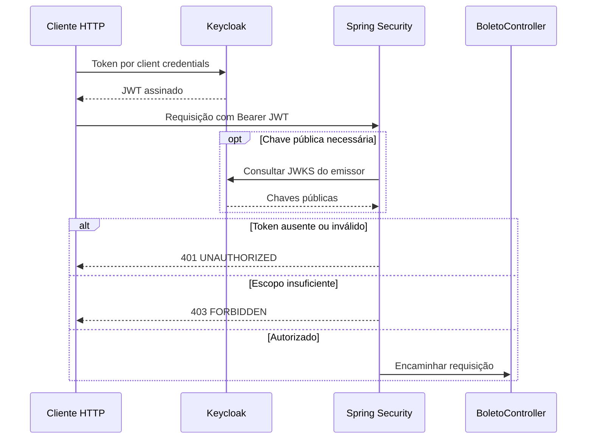

O Spring Security funciona como OAuth2 Resource Server sem sessão.
O Keycloak local emite JWTs para o realm `boleto-lab`. A API verifica
assinatura, emissor, timestamps e a audiência padrão `boleto-api` com
chaves públicas JWKS. As rotas exigem escopos por operação.

As permissões têm alcance sobre os dados sintéticos do laboratório. A
versão atual não modela isolamento de locatários nem propriedade por
cliente. A configuração local vincula a API e os serviços à interface de
loopback.

## Clientes de desenvolvimento

| Cliente OIDC | Escopos |
| --- | --- |
| `boleto-issuer` | `boletos:issue`, `boletos:read` |
| `boleto-reader` | `boletos:read`, `boletos:list` |
| `boleto-operator` | `boletos:pay`, `boletos:cancel`, `boletos:audit` |
| `boleto-metrics` | `ops:metrics` |

Abra o console administrativo local do Keycloak, selecione o realm e
consulte a aba de credenciais do cliente. O arquivo de realm do projeto não
contém os segredos gerados. Em Postman, preencha o segredo apenas como valor
local, execute o pedido **Get token** e mantenha tokens e segredos fora das
exportações compartilhadas.

Para solicitar um token manualmente, use a concessão `client_credentials`
com formulário URL-encoded:

```http
POST /realms/boleto-lab/protocol/openid-connect/token HTTP/1.1
Host: 127.0.0.1:8180
Content-Type: application/x-www-form-urlencoded

grant_type=client_credentials&client_id=boleto-reader&client_secret=<segredo-local>
```

O cliente envia o `access_token` como `Authorization: Bearer <token-local>`.
Veja a tabela de escopos por rota em [API REST](../referencia/api.md).

## Diagnosticar acesso

- `401 UNAUTHORIZED` indica JWT ausente ou inválido. Verifique emissor,
  audiência, expiração e a rota JWKS.
- `403 FORBIDDEN` indica que o JWT foi aceito, mas o cliente não tem a
  permissão pedida.
- As sondas de saúde retornam apenas status no ambiente local. Métricas
  exigem `ops:metrics`, e endpoints administrativos do Actuator ficam
  indisponíveis.

Use o Gitleaks no conteúdo candidato a versionamento. `.env` e
`application-local.yaml` permanecem ignorados. Os comandos de verificação
antes de commits e PRs estão no `README.md` do repositório.

## Fluxo de autenticação e autorização

O fluxo separa emissão do token, validação JWT e autorização por escopo. Veja a matriz de [rotas e escopos](../referencia/api.md).


