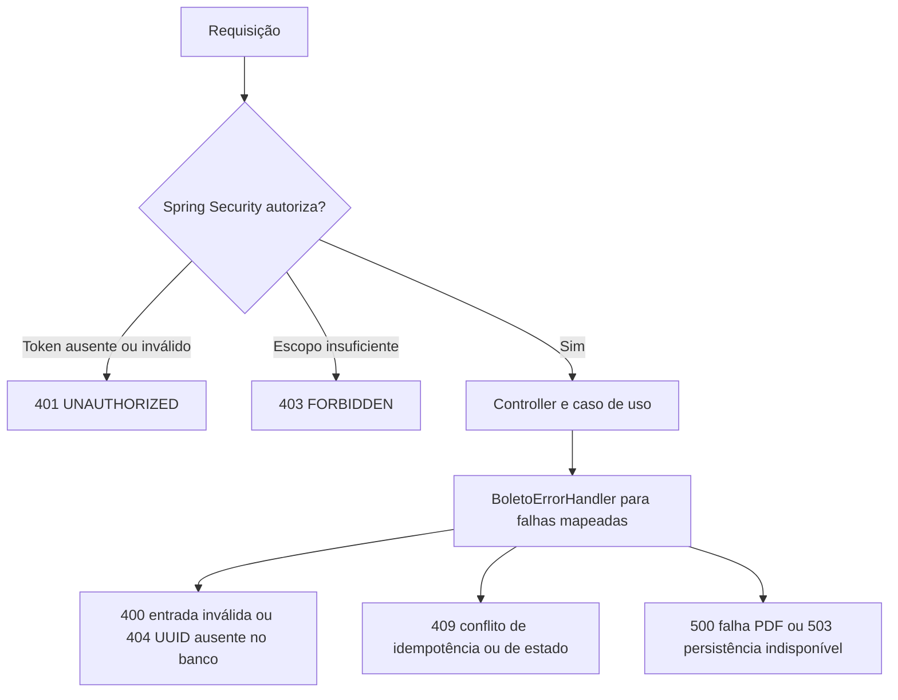

A base local padrão é `http://127.0.0.1:8080`. As rotas de boleto exigem
`Authorization: Bearer <token-local>`. Use o cliente OIDC com o escopo da
operação. Os exemplos abaixo usam dados fictícios. Ajuste o vencimento
para uma data futura ao testar.

| Método e rota | Escopo | Respostas da operação |
| --- | --- | --- |
| `POST /api/v1/boletos` | `boletos:issue` | `201` nova emissão, `200` replay, `400` entrada inválida, `409` conflito, `503` falha de acesso ao banco. |
| `GET /api/v1/boletos/{id}` | `boletos:read` | `200`, `400` UUID inválido, `404` inexistente. |
| `GET /api/v1/boletos/{id}/pdf` | `boletos:read` | `200` PDF, `400`, `404`, `500` falha na renderização. |
| `GET /api/v1/boletos` | `boletos:list` | `200` página, `400` filtro ou paginação inválida. |
| `POST /api/v1/boletos/{id}/payments` | `boletos:pay` | `200` pagamento simulado, `400`, `404`, `409` estado inválido. |
| `POST /api/v1/boletos/{id}/cancellations` | `boletos:cancel` | `200` cancelado, `400`, `404`, `409` estado inválido. |
| `GET /api/v1/boletos/{id}/history` | `boletos:audit` | `200` histórico, `400`, `404`. |

Todas as rotas protegidas podem retornar `401 UNAUTHORIZED` ou
`403 FORBIDDEN`. Uma indisponibilidade de persistência reconhecida pela
API pode retornar `503 DATABASE_UNAVAILABLE`.

## Emitir ou repetir uma emissão

```http
POST /api/v1/boletos HTTP/1.1
Host: 127.0.0.1:8080
Authorization: Bearer <token-local>
Content-Type: application/json
Idempotency-Key: demo-emissao-001

{"customerId":"cliente-ficticio-001","amount":42.50,"dueDate":"2099-12-31"}
```

O corpo contém apenas `customerId`, `amount` e `dueDate`. O identificador
de cliente aceita 1 a 120 letras ASCII, algarismos, pontos, hífens ou
sublinhados. O valor é um número JSON e a data segue `AAAA-MM-DD`. Campos
desconhecidos e campos JSON duplicados são rejeitados.

A nova emissão retorna `201 Created` e o cabeçalho
`Location: /api/v1/boletos/765af9bc-8430-49e5-9e79-6317fe26e8ed`.
O corpo abaixo também ilustra a consulta por UUID. O replay com dados
equivalentes retorna `200` e o mesmo UUID.

```json
{
  "id": "765af9bc-8430-49e5-9e79-6317fe26e8ed",
  "customerId": "cliente-ficticio-001",
  "amount": 42.50,
  "currency": "BRL",
  "dueDate": "2099-12-31",
  "status": "EMITIDO",
  "issuedAt": "2026-11-21T14:00:00Z"
}
```

Consulte [Idempotência e concorrência](../arquitetura/idempotencia.md) para
replays após o vencimento e a diferença entre os dois conflitos de chave.

## Consultar, baixar o PDF e listar

```http
GET /api/v1/boletos/765af9bc-8430-49e5-9e79-6317fe26e8ed
GET /api/v1/boletos/765af9bc-8430-49e5-9e79-6317fe26e8ed/pdf
GET /api/v1/boletos?customerId=cliente-ficticio-001&status=EMITIDO&page=0&size=20&sort=issuedAt,desc
```

As linhas acima representam requisições separadas. A rota de PDF envia
`application/pdf` com `Content-Disposition: attachment`, e o nome segue
`boleto-{id}.pdf`. O corpo é o PDF binário.

A listagem retorna `content` com boletos no formato da consulta e metadados
`page`, `size`, `totalElements` e `totalPages`. Uma busca vazia pode retornar:

```json
{"content":[],"page":0,"size":20,"totalElements":0,"totalPages":0}
```

| Parâmetro | Semântica |
| --- | --- |
| `customerId` | Filtro opcional pelo cliente fictício. |
| `status` | Estado efetivo. Aceita `EMITIDO`, `PAGO`, `VENCIDO` ou `CANCELADO`. |
| `from`, `to` | Datas inclusivas de emissão no fuso `America/Sao_Paulo`, no formato `AAAA-MM-DD`. |
| `page`, `size` | Índice iniciado em zero. Padrão `0` e `20`. Tamanho de 1 a 100 e limite de 100.000 para `page × size`. |
| `sort` | Campo e direção separados por vírgula. Padrão `issuedAt,desc`. Campos `issuedAt`, `dueDate`, `amount` e `id`, com `asc` ou `desc`. O UUID resolve empates. |

## Simular pagamento, cancelar e consultar histórico

```http
POST /api/v1/boletos/765af9bc-8430-49e5-9e79-6317fe26e8ed/payments
POST /api/v1/boletos/765af9bc-8430-49e5-9e79-6317fe26e8ed/cancellations
GET /api/v1/boletos/765af9bc-8430-49e5-9e79-6317fe26e8ed/history
```

Os comandos aceitam requisição sem corpo e devolvem o DTO do boleto com
`PAGO` ou `CANCELADO`. Use boletos distintos ao testar os dois comandos,
pois ambos exigem estado `EMITIDO`. O histórico devolve um array de objetos:

```json
[
  {
    "eventId": "91d3d7c7-e049-4760-8b07-fc85d62142c5",
    "eventType": "BOLETO_ISSUED",
    "timestamp": "2026-11-21T14:00:00Z",
    "source": "API",
    "previousStatus": null,
    "newStatus": "EMITIDO",
    "correlationId": "68c163576f864c19b8d5353fc107bbb7"
  }
]
```

## Formato de erro

Os erros tratados usam `application/problem+json` e o campo estável
`code`. Respostas podem omitir `detail`, como nos erros de autenticação.

```json
{
  "type": "about:blank",
  "title": "Conflict",
  "status": 409,
  "detail": "Issuance is in progress. Retry after the indicated delay.",
  "code": "OPERATION_IN_PROGRESS"
}
```

| Código | HTTP | Ação |
| --- | --- | --- |
| `INVALID_REQUEST` | 400 | Corrigir corpo, chave, data, UUID ou parâmetros. |
| `UNAUTHORIZED` | 401 | Fornecer JWT válido para o emissor e audiência configurados. |
| `FORBIDDEN` | 403 | Usar um cliente com o escopo da operação. |
| `BOLETO_NOT_FOUND` | 404 | Conferir o UUID. |
| `IDEMPOTENCY_CONFLICT` | 409 | Corrigir o uso da chave para combinar com a emissão original. |
| `OPERATION_IN_PROGRESS` | 409 | Repetir após `Retry-After: 1`. |
| `INVALID_STATE_TRANSITION` | 409 | Consultar o estado atual antes de enviar outro comando. |
| `PDF_RENDER_FAILED` | 500 | Tentar novamente a requisição de PDF. |
| `DATABASE_UNAVAILABLE` | 503 | Verificar o banco e repetir de acordo com a semântica da operação. |

Para configurar um cliente e obter um token, consulte
[Segurança](../operacao/seguranca.md).

## Como manter a referência

O contrato atual é documentado a partir de `BoletoController`,
`IssueBoletoRequest`, `BoletoErrorHandler` e `BoletoSecurity`, com exemplos
na coleção Postman e testes HTTP com PostgreSQL. Ao alterar uma rota,
atualize essas referências na mesma revisão e confirme códigos de resposta,
validação, escopos e exemplos nos testes correspondentes.

O projeto ainda não publica OpenAPI. Uma futura geração a partir dos
controllers deve validar o resultado contra os testes HTTP. Revise
explicitamente o corpo recebido como `JsonNode`, os campos de
`ProblemDetail`, os escopos e os cabeçalhos de idempotência. Esses detalhes
exigem mais informação do que as assinaturas dos métodos mostram.
Para executar exemplos, use a [coleção Postman local](../inicio/executar.md#usar-o-postman).

## Mapeamento de erros

O filtro de segurança trata credenciais e escopos. O advice MVC trata as falhas conhecidas da API. Consulte a seção [Formato de erro](#formato-de-erro) e [Segurança](../operacao/seguranca.md).



## Revisões técnicas

Com o escopo `boletos:audit`, consulte `GET /api/v1/boletos/{id}/revisions`, `GET /api/v1/boletos/{id}/revisions/{revision}` ou `GET /api/v1/boletos/{id}/revisions/compare?from=39&to=42`. A lista aceita `before` e `size`. As respostas e regras de histórico estão descritas em [Auditoria e Histórico de Entidades](../arquitetura/auditoria.md#consultas).
