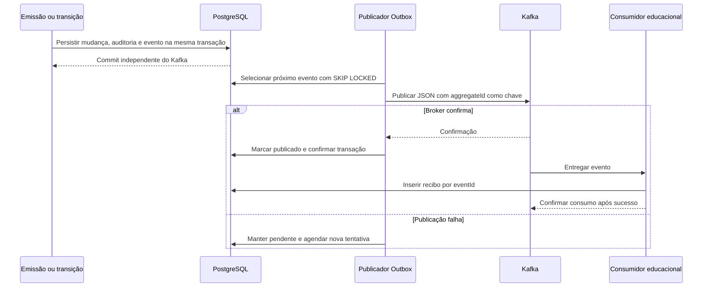
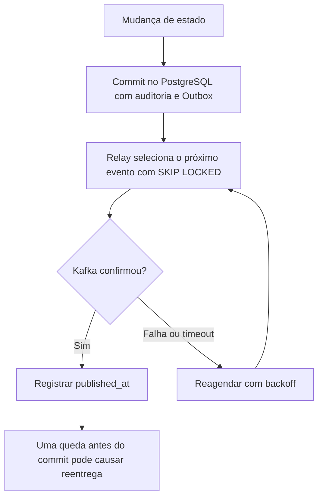

O tópico padrão é `boleto.lifecycle.v1`. A aplicação publica um registro
com o UUID do boleto como chave Kafka e uma **string JSON** serializada com
Jackson como valor. O perfil `platform` habilita publicação e consumo.
`BPL_EVENTS_ENABLED` permite sobrescrever essa opção. Mesmo com o envio
desabilitado, a alteração de domínio registra o Outbox.
O grupo `boleto-lab-educational` e o tópico são autorizados para
`svc-boleto-api`. Em execução de plataforma, o provisionamento cria
o tópico antes de iniciar os clientes. Veja o
[guia de segurança Kafka](../operacao/kafka-seguro.md).

## Contrato vigente

Os tipos são `BOLETO_ISSUED`, `BOLETO_PAID`, `BOLETO_EXPIRED` e
`BOLETO_CANCELED`. O evento tem a versão de contrato `version: 1`.
`aggregateVersion` é a versão do boleto e permite ordenar as mudanças
do mesmo agregado. O evento carrega identidade técnica e correlação,
sem valor, senha ou token.

```json
{
  "eventId": "91d3d7c7-e049-4760-8b07-fc85d62142c5",
  "eventType": "BOLETO_ISSUED",
  "aggregateId": "765af9bc-8430-49e5-9e79-6317fe26e8ed",
  "timestamp": "2026-11-21T14:00:00Z",
  "version": 1,
  "aggregateVersion": 0,
  "correlationId": "68c163576f864c19b8d5353fc107bbb7"
}
```

Avro e Schema Registry estão registrados no [roadmap](../roadmap.md)
como proposta. A [ADR de Avro](../decisoes/avro.md) descreve as decisões
ainda necessárias para migrar o formato.

## Processamento assíncrono



O publicador processa um evento por transação e aplica o limite de até
quatro publicações por rodada. Uma falha adia a próxima tentativa com
backoff exponencial e jitter, limitado a um minuto. Eventos com versões
posteriores aguardam o evento anterior pendente do mesmo boleto.

Uma queda entre o ACK Kafka e o commit do Outbox pode provocar nova
entrega. A garantia é *at-least-once*. O consumidor educacional usa
`processed_boleto_event` e trata um `eventId` já recebido como repetição.
O registro do recibo ocorre antes de a entrega ser considerada processada.

O processamento Kafka pode propagar `traceparent`. Veja
[Observabilidade](../operacao/observabilidade.md) para seguir a correlação
entre HTTP, publicação e consumo.

## Ciclo do Transactional Outbox

O relay libera a linha após registrar a confirmação ou reagendar uma falha. Consulte o [ADR 003](../decisoes/outbox.md).


